# Twigo: Current System Behavior Report

| | |
| --- | --- |
| Prepared | 24 November 2026 |
| Code examined | Branch `main`, HEAD `cf422db` ("Record Sacramento, California as the production jurisdiction"), **plus the uncommitted working tree** (see 2.4) |
| Release package | `twigo-rc5-2026-11-23` (built from commit `b7115c8`; not deployed) |
| Purpose | Evidence-based description of how the Twigo website actually behaves today. Investigation and documentation only: no application code, schema, design or configuration was changed, nothing was deployed, and no production system was contacted. |
| Later update | Findings C-1 and H-1, H-5 and H-7 were addressed afterwards the same day; see [TWIGO-LEGAL-DOCUMENTS-RESOLUTION-REPORT.md](TWIGO-LEGAL-DOCUMENTS-RESOLUTION-REPORT.md). This report is kept as it was written. |

---

## 1. Executive Summary

**What Twigo is, in software terms.** Twigo is a single Next.js 16 / TypeScript application with a PostgreSQL database (Prisma 6), a built-in Socket.IO chat server and an hourly in-process job scheduler, packaged for Docker on port 1010. It implements a members-only online community with this operating model:

1. A visitor reads the public site and creates a free account (name, email, password, three legal checkboxes).
2. The visitor confirms their email address and fills in a four-step membership application.
3. An administrator reviews the application (review, interview request, waitlist, accept or decline). Acceptance gives community access immediately.
4. Members propose business ideas. When **two other active members** support an idea (an owner-adjustable setting, default 2), a "project group" is created automatically and the idea's author becomes its coordinator.
5. Any member can join any open group without approval. Groups have a real-time chat, Google Meet link sharing, a research workspace (notes, tasks, decisions, links, files), discussions and announcements.
6. Inside a group, members can create a "group project" and write a versioned project agreement. Every listed participant must accept the exact text before the project can be marked "commercially active".
7. Money never passes through the platform. Compensation is written as free text inside agreements; there is no payment processing, payout, commission, revenue tracking or contribution tracking in the software.

**What was verified by execution today (24 November 2026, local machine, synthetic data only).**
- The full automated test suite (`npx vitest run`): **38 test files, 438 tests passed, 0 failed** against the isolated test database `cowork_test`.
- A live browser walk-through on the local demo database (`cowork_demo`, fictional `@demo.test` accounts, email captured locally): registration, email confirmation, the four-step application, owner sign-in with two-step verification, approval, first member login, supporting an idea until a group formed automatically, joining a group, sending a chat message (persisted in PostgreSQL), and the meetings page.
- HTTP status of every public route (all 21 public pages return 200; legacy addresses redirect with 308; private areas redirect to sign-in).

**What is not working or not done.**
- **Twigo is not deployed.** The project's own documents record that the first real VPS runs failed at the settings check and that the domain answered with a Cloudflare 525 error on 23 November. There is no record of a successful production deployment. (Per documents; not re-checked today, because production must not be touched.)
- **Real email has never been sent.** The Resend API key is intentionally empty; nothing in the repository shows a successful delivery through Resend. Because sign-up requires email confirmation, **nobody can join until real email works.**
- **Legal documents are unreviewed drafts in every database examined, and the uncommitted working tree removes the notice that says so.** In the local demo database all eight documents are version 1 with status `PENDING_LEGAL_REVIEW`. With the uncommitted edits, `/legal/*` and `/join` no longer show "Draft awaiting legal review"; a synthetic account created today accepted those draft versions without any draft disclosure (verified by execution and in the database). The founder has stated that a lawyer reviewed the texts; the application cannot verify that, and the texts themselves still say several things will be decided "before this policy is published".
- Several features the public pages describe exist only as principles: no contribution records, no revenue or distribution tracking, no payments, no self-service account deletion, and no way for members to report an individual chat message (although the chat screen promises administrators see a message "only if someone reports it").

**Implementation status matrix totals (Section 18, 64 features):** 20 VERIFIED · 21 IMPLEMENTED — NOT FULLY VERIFIED · 11 PARTIALLY IMPLEMENTED · 2 NOT WORKING · 2 EXTERNAL DEPENDENCY · 7 NOT IMPLEMENTED · 1 UNKNOWN.

**Readiness verdict (Section 20).** Not ready for public US recruitment at any scale today, because the site is not online, email does not work in production, and the legal-document state is undisclosed. After the five actions in Section 22 are completed, the software is suitable for a **small, invited, founder-supervised pilot** (roughly up to 30 people, the scale the code was designed for). It is not ready for moderate or large-scale public recruitment.

---

## 2. Scope and Methodology

### 2.1 What was examined

- Every route under `src/app` (public site, authentication, applicant, account, community portal, admin panel, API routes), all server actions (13 `"use server"` files), `src/server/**`, `src/lib/**`, `src/realtime/**`, `src/ops/**`, `src/content/legal/**`, the Prisma schema (`prisma/schema.prisma`, 1,482 lines, 56 tables) and all 10 migrations, `server.ts`, `next.config.ts`, `Dockerfile`, `docker-compose*.yml`, the deployment scripts (`deploy-twigo.ps1`, `scripts/deploy/*`), the test suites (`tests/*.test.ts`, `tests/e2e/*`) and the existing documentation under `docs/`.
- Existing documents were cross-checked against the code and are cited as "per docs" where they could not be confirmed. Several were found to be out of date (Section 17.5).

### 2.2 How each conclusion is labelled

Every conclusion in this report carries one of these evidence labels:

| Evidence label | Meaning |
| --- | --- |
| **[Executed]** | Verified by execution today: a browser action against the local demo server, an automated test that passed today, or a direct database query. |
| **[Source]** | Confirmed by reading the source code; not executed. |
| **[Inferred]** | Follows from the code but was neither executed nor directly stated in it. |
| **[Docs]** | Stated only in the project's own documents; not verified. |

Implementation statuses (Section 18 and elsewhere) are mutually exclusive:

| Status | Used when |
| --- | --- |
| VERIFIED | The core behavior was exercised today, in the browser or by a named automated test that passed today. |
| IMPLEMENTED — NOT FULLY VERIFIED | The code exists and appears complete for its purpose, but its core behavior was not exercised today. |
| PARTIALLY IMPLEMENTED | Part of the intended purpose is missing or contradicts what the site tells users. |
| NOT WORKING | Exists or is intended, but currently does not achieve its purpose. |
| EXTERNAL DEPENDENCY | Cannot work until an outside account, service or configuration (outside this repository) is in place. |
| NOT IMPLEMENTED | No code exists for it. |
| UNKNOWN | Cannot be determined from the repository or from local execution. |

### 2.3 What was executed

| Check | Environment | Result |
| --- | --- | --- |
| `npx vitest run` | Embedded PostgreSQL on port 5433 (`npm run db:up`), database `cowork_test` | **38 files, 438 tests passed, 0 failed, 0 skipped** (545 s). Two `EAUTH` log lines during the run belong to tests that deliberately simulate a refusing mail server. |
| HTTP status crawl | Local dev server (`demo` launch configuration) on `127.0.0.1:3101`, database `cowork_demo` | All public routes 200; `/privacy`, `/terms`, `/community-rules` → 308; `/community`, `/admin`, `/account`, `/application`, `/legal/review` → 307 to `/login?next=…`; unknown route → 404; `/api/health` → `{"status":"ok","db":"ok"}` |
| Browser walk-through | Same server; fictional accounts from `scripts/demo-config.ts` plus one new synthetic account (`audit-reg@demo.test`) | See 2.5 |
| Database queries | `cowork_demo` (read, plus the records the walk-through created) | Legal version states, acceptance records, email delivery records, chat persistence, audit entries |

**Not executed:** the Playwright browser suite (`npx playwright test`), the deployment/launcher test suites (they need WSL Docker), `tsc`, ESLint, Docker builds, and anything involving the VPS, Cloudflare, the central Caddy or Resend. Where this report relies on those, it says "per docs".

**Side effects of the walk-through:** the local demo database `cowork_demo` now contains one extra synthetic account (`audit-reg@demo.test`), one automatically created group ("Evening tutoring for adults going back to school"), one chat message and the related audit, notification and captured-email rows. No real email was sent (all mail went to the local capture inbox, status `CAPTURED_LOCALLY`). No database was reset or deleted.

**Port note:** the configured demo port 3100 was occupied by another local process, so the server ran on 3101 while `SITE_URL` still said 3100. Links inside captured emails therefore pointed to port 3100 and were opened on 3101 by hand. This is a local test artifact, not a product defect.

### 2.4 The uncommitted working tree

Five files have uncommitted edits made by someone other than this investigation. They were not modified, reverted or committed. This report describes the working tree **with** these edits, because that is what would be built next.

| File | Change | Does it change behavior? |
| --- | --- | --- |
| `src/app/(site)/legal/page.tsx` | Removes the "Version N · status" badge for each document and the sentence about versions | **Yes.** Visitors no longer see whether a policy is a draft or published. |
| `src/app/(site)/legal/[key]/page.tsx` | Removes `StatusNotice` (the "Draft awaiting legal review" banner, or "In force since…" for published texts), `DocumentFacts` (version, dates, fingerprint) and the "All versions" list | **Yes.** No draft disclosure, no effective date, no version history on public pages. |
| `src/app/(site)/legal/[key]/v/[version]/page.tsx` | Removes the status notice, facts and fingerprint; the heading no longer shows the version number | **Yes.** A superseded old version is no longer marked "no longer in force" and looks identical to the current one. |
| `src/app/(auth)/join/page.tsx` | Removes "These documents are drafts awaiting legal review. If a reviewed version changes them materially, you will be asked to accept it." | **Yes.** People accept the Terms without being told they are drafts. |
| `scripts/audit/walkthrough.ts` | The walkthrough step now asserts the draft banner is **absent** | Changes the test expectation only. |

Data, acceptance recording and the re-acceptance gate are unchanged; the edits are display-only [Source]. Their effect was confirmed [Executed]: `/legal/terms` contains no draft banner, while the database lists all eight documents as `PENDING_LEGAL_REVIEW`, and the synthetic account's acceptance records point to those pending versions. The unused components remain in `src/components/legal/document-view.tsx`. These edits also contradict the rule written in `src/server/legal.ts:17-18` (an unpublished latest version "is shown with a clear notice that it is a draft"). See finding C-1.

### 2.5 Browser walk-through steps (all [Executed])

1. `/login` as the fictional member Maya → lands on `/community` (the Business Ideas feed).
2. Pressed **Support** on "Evening tutoring for adults going back to school", which had one supporter → redirected to the new group page with "Your support was the last one needed, so a project group has been created and you are a founding member." The group showed Stage "Forming", 3 members, the idea's author as Coordinator. Audit entry `group.auto_created` written; notification emails captured locally.
3. Group chat: typed and sent a message; it appeared and was stored in `ChatMessage` (kind `USER`).
4. Phone width (375 px) `/community`: no horizontal overflow; bottom navigation (Ideas, Explore, My Groups). At 1,024 px the chat page had 8 px of horizontal overflow (minor).
5. Signed out; `/join` with a new synthetic account → `/verify-email?sent=1` ("Check your email… Development mode. Emails are captured on this computer"). `EmailDelivery` row `account_verification` with status `CAPTURED_LOCALLY`.
6. Opened the link from the captured email → "Confirm my email" button (POST) → signed in automatically → `/apply?verified=1`.
7. Completed steps 1–4 of the application → `/application?submitted=1`, status "Application Received".
8. Signed in as the demo owner with password and a TOTP code → `/admin`. Overview showed "Before launch (10 open)": jurisdiction and governing law not confirmed, and all eight legal documents still needing legal review and publication.
9. Opened the application → ticked the confirmation → **Approve and Notify** → "Approved. This person can now enter the member community… Test email captured locally."
10. Signed in as the new member → landed directly on `/community` with "Welcome, Audit Tester" (no welcome or profile step).
11. Joined the new group with one click (no approval) → 4 members. Meetings tab: paste-a-Google-Meet-link flow.

---

## 3. Public Website and Visitor Experience

### 3.1 Site frame

- **Header** (`src/components/site/header.tsx`, `src/components/site/nav.ts:2-7`): logo → `/`; desktop links How It Works, About, Pay & Fairness, FAQ; "Sign In" (hidden below the small breakpoint); "Join Twigo" (always visible). Contact is not in the header [Source].
- **Phone menu** (`src/components/site/mobile-nav.tsx`): hamburger below the large breakpoint; the four links, a collapsed "More pages" list with nine more, then Join and Sign In; closes on navigation and Escape. No focus trap or outside-click close [Source].
- **Footer** (`src/components/site/footer.tsx`): "No membership fees. No investment required. No guaranteed earnings…", the contact email if configured, three link groups, copyright with the legal name or organization name, and a note that photographs are illustrative (stock photos exist under `public/images/people/`) [Source].
- **Errors:** custom 404 with "Back to home" (verified [Executed]); `error.tsx` offers "Try again" but no home link; there is no `global-error.tsx` [Source].
- **SEO:** `robots.ts` blocks private areas; `sitemap.ts` lists 21 public paths including `/join`, although `/join` is marked `noindex` by its layout and by a header rule in `next.config.ts` (a minor contradiction) [Source].
- Site pages are regenerated at most every 5 minutes (`revalidate = 300`, `src/app/(site)/layout.tsx:8`) [Source].

### 3.2 What administrators can edit

Only six content blocks are editable in **Admin → Website content** (`src/lib/content/schema.ts:5-33`, permission `content.edit`, held by ADMIN and OWNER): company tagline and mission, the home hero text, an announcement, the public contact email and response note, the FAQ items (up to 40) and the participation categories (up to 20). Everything else on every public page is fixed in code. The company name always comes from the `ORG_NAME` setting; an edited name is ignored (`src/lib/content/index.ts:28-31`) [Source]. The hero headline uses the slogan from `ORG_TAGLINE`, while the footer uses the editable tagline (default "An Online Collaborative Community"), so the site shows two different taglines [Source].

### 3.3 Page by page

All pages below returned HTTP 200 today [Executed]. No link pointing to a non-existent route was found in any public page, header, footer, phone menu or authentication page [Source].

| Page | Purpose and content | Actions and where they lead | Admin-editable | Notes and placeholders |
| --- | --- | --- | --- | --- |
| **Home** `/` | Slogan "Together We Innovate, Grow & Opportunity", what Twigo is, four-step journey, who can participate, how money works, founding contributors, a transparency note ("one founder, no established membership, no completed projects… its legal operator has not yet been formally established") | Join → `/join`; See how it works → `/how-it-works`; Explore participation areas → `/participation`; How money works → `/compensation`; About founding contributors → `/founding-contributors`; Read the FAQ → `/faq` | Hero, mission, announcement | States "two members other than the author" as fixed text although the threshold is an owner setting |
| **About** `/about` | Mission, why the community exists, six principles, "Honestly, today", long-term vision | No call to action in the body (header/footer only) | Mission | Fixed text says the legal operator and jurisdiction are not yet confirmed (`about/page.tsx:96-98`) |
| **How It Works** `/how-it-works` | Three phases, ten steps; "three things always true" | Join and FAQ buttons | No | Says the application "takes about 5 minutes"; meetings "through Google Meet"; fixed "two members" threshold |
| **Participation** `/participation` | Areas of work (categories), a "no training offered" notice, "Current opportunities" | No call to action in the body | Categories | Opportunities come only from the earlier admin-run project records (`src/server/public.ts:10-36`); with none, it says there are no confirmed opportunities |
| **Pay & Fairness** `/compensation` | No fees or commission; an illustrative revenue diagram; four sharing arrangements; commitments versus "what we do not promise"; payment timing | Links to `/legal/participation-compensation` and `/support`; no Join button in the body | No | The diagram is labelled "Illustration only" |
| **Founding Contributors** `/founding-contributors` | Who founding contributors are | Join as a founding contributor → `/join`; How it works | Announcement text | Says "Applying takes about 10 minutes", contradicting "5 minutes" elsewhere |
| **FAQ** `/faq` | 14 questions and answers | None | All items | Mentions "the contact page" and the "Intellectual Property Policy" without linking them; fixed "two members" threshold |
| **Contact** `/contact` | Contact form (participant, business or general) | Form submission; "create a free account and apply" → `/join` | Email and response note | Shows the email if configured, otherwise "An email address will be published once it is confirmed" |
| **Work with us** `/work-with-us` | For businesses: "not an agency", what to expect | Business version of the contact form | No | — |
| **Community Support** `/support` | Voluntary support principles, published report totals | Link to `/legal/community-support` | No | "Online contributions are not available" (always). Says "No support has been received" whenever no report is published (Section 11.4) |
| **Legal index** `/legal` | List of the eight policies with summaries and where each is accepted | Links to each policy and to `/legal/notices` | No (owner edits texts via Admin → Legal) | Working tree: no version or status shown |
| **Terms, Privacy, Community Guidelines** and five other policies `/legal/<key>` | The policy text | — | Owner only, via versioning | Working tree: no draft banner, no version history (2.4) |
| **Legal notices** `/legal/notices` | Operator name, entity type, jurisdiction, address, registration number, contact | — | Owner via Admin → Legal → Legal notices | Locally: operator "Twigo" and the contact address shown; entity type, jurisdiction, address and registration number "Not yet confirmed" [Executed] |
| `/privacy`, `/terms`, `/community-rules` | Redirects | 308 → `/legal/privacy`, `/legal/terms`, `/legal/community-guidelines` [Executed] | — | — |
| **Apply** `/apply` | The membership application (Section 5) | Signed-out visitors are sent to `/join` [Executed] | No | — |
| **Sign In** `/login` | Email and password; "Forgot Password?" | → `/continue`, which routes by account state | No | Two-step code page at `/login/verify` |
| **Sign Up** `/join` | Account creation (Section 4) | → `/verify-email` | No | No footer and no legal-notice link on authentication pages |

There is no separate "Compensation" page under that name (the page is titled "Pay & Fairness" at `/compensation`), no separate "Participation" policy page other than `/legal/participation-compensation`, and no "Community Guidelines" page outside `/legal/community-guidelines`.

**Contact form behavior** [Source]: a hidden honeypot field (a filled one gets a fake success), a signed timestamp that must be 3 seconds to 6 hours old, validation (message 10–4,000 characters), a limit of 5 messages per hour per network address (kept in memory), storage in `ContactInquiry`, and an email to administrators only if `ADMIN_NOTIFICATION_EMAIL` is set (`src/server/contact.ts:27-56`).

**Desktop and phone** [Executed for one page, Source otherwise]: layouts use responsive breakpoints; the member area at 375 px had no horizontal overflow. The project's documents report that all 19 public pages were checked at 375 px without overflow by the browser suite [Docs]; that suite was not run today.

### 3.4 The visitor journey

1. **Home** explains Twigo mostly by what it is not: not an employer, recruitment agency, investment or job board; no fees; no commission; no guarantees.
2. **How It Works** shows the full path: join → apply → be accepted → propose or support ideas → form a group → research → agree terms → work.
3. **Join** creates an account; the visitor must then open an email, confirm, and complete the application, and then wait for a person to review it.

### 3.5 Trust and understanding barriers for a first-time American visitor

| Barrier | Evidence |
| --- | --- |
| It takes effort to grasp what Twigo *is*: the pages lean on negatives and internal terms ("project group", "supporting an idea", "founding contributor", "voluntary community support") | Home, How It Works, FAQ [Source] |
| No named person, company or address behind the site; the site itself says there is one founder, no membership, no completed projects | Home transparency note (`src/app/(site)/page.tsx:222-226`), About [Source] |
| Mixed messages about who runs it: Legal Notices take operator and jurisdiction from settings and mark them confirmed automatically (`src/server/legal-notices.ts:44-57`), while About, Home, Terms §1 and §21 and the Privacy Policy say the operator and governing law are not yet determined | [Source]; with the committed template the "Governing law" line would read "Sacramento, California" (a city, not a body of law) [Inferred] |
| Legal documents carry no draft notice in the working tree, yet their own text says things will be named "before this policy is published" (`src/content/legal/privacy.ts:97,105`) | 2.4 [Executed] |
| The slogan "Together We Innovate, Grow & Opportunity" reads as a grammatical error to many US readers | `src/config/brand.ts:40`; kept word-for-word at the founder's instruction [Docs] |
| Inconsistent small facts (5 vs 10 minutes to apply; a fixed "two members" rule that admins can change) | 3.3 [Source] |
| Real email from the domain has never been delivered; first-time visitors may never receive the confirmation email | Section 13 |

---

## 4. Account Registration and Authentication

### 4.1 Registration (`/join`)

| Item | Behavior | Evidence |
| --- | --- | --- |
| Fields | Full name (2–120 characters), email (trimmed, lowercased, valid, ≤254), password and confirmation, and three separate checkboxes: accept Terms of Use, accept Community Guidelines, acknowledge the Privacy Policy ("not a consent") | `src/lib/validation/account.ts:5-18`, `src/app/(auth)/join/page.tsx` [Source]; all three boxes required [Executed] |
| Password rule | 12–128 characters, at least one letter and one digit; no check against breached or common passwords | `src/lib/auth/password.ts:50-55` [Source] |
| Password storage | scrypt (N=2^15, r=8, p=1), random 16-byte salt, constant-time comparison; older bcrypt hashes are accepted and upgraded at next sign-in | `src/lib/auth/password.ts:15-40` [Source] |
| Duplicate email | Same response as a new sign-up (redirect to "check your email"); the existing owner of the address receives an `account_exists` email instead; a dummy password hash equalizes timing. The page does not reveal whether an address is registered. | `src/server/onboarding.ts:47-57` [Source]; test "simultaneous sign-ups with the same address create exactly one account" passed [Executed] |
| Legal records | One `LegalAcceptance` row per document (Terms ACCEPTED, Guidelines ACCEPTED, Privacy ACKNOWLEDGED) with version and content fingerprint, in the same transaction as the account; if the displayed document changed while the form was open, sign-up is refused | `src/server/onboarding.ts:61-97` [Source]; rows observed for the synthetic account [Executed]; test "each consent is separate: missing any one of the three stops registration and creates nothing" passed [Executed] |
| Bot protection | Honeypot field; 10 sign-ups per hour per network address and 5 per email address (in memory). No CAPTCHA and no signed timing token. | `src/app/(auth)/actions.ts:76`, `onboarding.ts:44` [Source] |
| Account state created | `status = ACTIVE`, `role = MEMBER`, `membershipStatus = NONE`, email not yet verified | `onboarding.ts:79-90` [Source] |

### 4.2 Email verification

- A random 32-byte token is emailed; only its SHA-256 hash is stored; issuing a new one cancels older unused ones; it is single-use and expires after **24 hours** (`src/lib/auth/tokens.ts`, `src/lib/auth/constants.ts:12`) [Source].
- Opening the link shows a page with a **"Confirm my email"** button; only pressing it (a POST) consumes the token, so email security scanners cannot use it up [Executed].
- Confirming as an ordinary member without two-step verification **signs the person in automatically** with no password (`src/app/(auth)/actions.ts:135-145`) [Executed]. Staff and two-step accounts are sent to sign in normally [Source; test passed].
- **Resend:** "Send the email again" with a 60-second cooldown and 8 per hour (signed in), or a public form limited to 10 per hour per network address that answers identically for any address. A person who typed a wrong address can sign in and correct it before confirming (5 per hour) [Source].
- **An unverified account can** sign in, open `/account/*` (settings, sessions, data export, privacy requests). It **cannot** apply or enter the community (`src/lib/auth/guard.ts:66-71`, `src/lib/auth/session-core.ts:27-30`) [Source]. Unverified accounts are never automatically removed (no rule in `src/ops/retention.ts`) [Source].

### 4.3 Sign-in, sessions and two-step verification

| Item | Behavior | Evidence |
| --- | --- | --- |
| Session type | Database sessions (not JWT). A random 32-byte token in an HttpOnly cookie (`__Host-cw_session` in production, Secure, SameSite=Lax); only the hash is stored | `src/lib/auth/session.ts:19-55` [Source] |
| Lifetime | Members 14 days (`MEMBER_SESSION_TTL_HOURS`, default 336); administrators 8 hours (`SESSION_TTL_HOURS`). **Absolute, not sliding.** Staff sessions also end after 60 minutes idle. A password-passed, code-pending session lasts 10 minutes | `src/lib/env-schema.ts:16-17`, `src/lib/auth/session-core.ts:84-91`, `constants.ts` [Source] |
| Errors | Generic "Invalid email or password."; a suspension message appears only after a correct password; invited-but-unactivated and deactivated accounts get the generic error | `src/lib/auth/service.ts:17,74-75` [Source] |
| Rate limits | 20 attempts per 15 minutes per network address; 5 failures lock that email from that network for 15 minutes; 50 per 15 minutes per account; 5 code attempts per pending session | `service.ts:27-56,106-110` [Source]. **All kept in process memory** (`src/lib/rate-limit.ts`); they reset on restart |
| Two-step verification | TOTP (RFC 6238, 6 digits, 30 s, ±1 step), secret encrypted with AES-256-GCM using `ENCRYPTION_KEY`; 10 single-use recovery codes (hashed). **Required for OWNER and ADMIN** to open the admin panel (default `ADMIN_REQUIRE_2FA=true`; production refuses to start if turned off). Optional for members, who may switch it off; staff may not | `src/lib/auth/totp.ts`, `src/lib/crypto.ts:29-33`, `src/lib/auth/guard.ts:54`, `src/server/accounts.ts:295-297` [Source]; owner sign-in with code [Executed] |
| Gap | The two-step requirement applies to `/admin` only. A staff account that has not enrolled can use the community and chat with a password alone | `guard.ts` [Source] |
| Code replay protection | In memory only | `totp.ts:24-37` [Source] |
| Several devices | No limit. **Account → Security** lists active sessions and can end one or all others | `src/app/account/security/page.tsx:114-143` [Source] |

### 4.4 Sign-out and session invalidation [Source]

| Event | Sessions ended |
| --- | --- |
| Sign out | The current one (live chat sockets of that session are disconnected) [Executed for sign-out] |
| "Sign out of all other devices" | All except the current |
| Password change | All others |
| Password reset | All |
| Email change confirmed | All |
| Two-step verification turned on | All others |
| Account suspended or deactivated | All, and live chat is disconnected |
| Role changed | All |
| Community access paused or removed | **None** — access is recalculated on every request and the live chat is told to disconnect the person |

### 4.5 Password reset [Source]

- `/forgot-password` always shows the same message; the email is sent in the background, only for active accounts with a password, limited to 10 per hour per network address and 3 per hour per account (`src/server/accounts.ts:158-175`).
- The token is hashed, single-use and valid for **1 hour**; a new request cancels earlier links.
- Resetting sets the new password (same policy), marks the email as verified, ends **all** sessions, and leaves two-step verification on (`accounts.ts:177-197`).
- Not exercised in the browser today; status IMPLEMENTED — NOT FULLY VERIFIED.

### 4.6 Account states actually implemented

`AccountStatus` = `INVITED`, `ACTIVE`, `SUSPENDED`, `DEACTIVATED`; separately `CommunityMembership` = `NONE`, `ACTIVE`, `SUSPENDED`, `REVOKED`; email verification is a date (`prisma/schema.prisma:31-45`) [Source]. `INVITED` is used for administrator invitations (`/activate/[token]`, 7-day link) and a legacy member-invitation path that is no longer reachable from the interface except through an email retry (`src/server/email-retry.ts:41-49`) [Source].

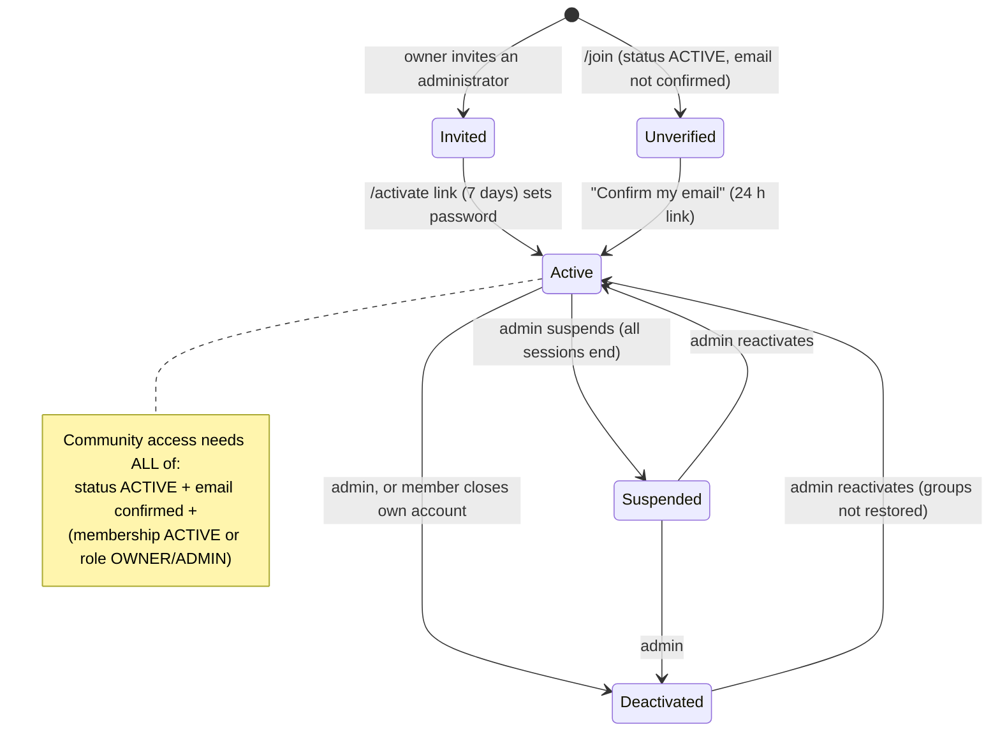

**Dead end** [Source]: a person whose account was deactivated (including by themselves) and who tries to sign up again receives an `account_exists` email telling them to sign in or reset their password, but sign-in returns "Invalid email or password" for deactivated accounts and reset emails are not sent to them. Only an administrator can reactivate, and nothing tells the person so.

---

## 5. Membership Application System

### 5.1 Fields (`src/lib/validation/application.ts`, `src/app/(applicant)/apply/page.tsx`, stored by `src/server/membership-application.ts:74-119`) [Source; flow Executed]

Name and email come from the account and are not asked again.

| Step | Field | Required | Rule | Stored in |
| --- | --- | --- | --- | --- |
| 1 About you | Country | Yes | 1–80 characters | `Applicant.country` |
| | State or region | No | ≤80 | `Applicant.region` |
| | What do you do now? | Yes | 1–160 | `Applicant.occupation` |
| | Work experience level | No | None / Entry / Intermediate / Experienced / Expert / prefer not to say | `Application.experienceLevel` |
| | Experience to mention | No | ≤2,000 | `Application.relevantExperience` |
| | Education | No | ≤160 | `Applicant.education` |
| | LinkedIn, portfolio or resume link | No | must start with `https://` | `Applicant.profileUrl` |
| 2 Skills and time | Skills and abilities | Yes | Split into up to 15 tags | `ApplicantSkill` (primary) |
| | Kinds of work that interest you | Yes | 1–7 of the seven categories | `WorkPreference` |
| | Hours per week | Yes | 2, 5, 10, 15, 20, 30 or 40 offered | `Availability.hoursPerWeek` |
| | Willing to learn new skills | Checkbox | ticked by default | `Application.willingToLearn` |
| | Usual availability, desired work, other skills | No | ≤200 / ≤1,000 / ≤500 | `Availability`, `Application`, `ApplicantSkill` (secondary) |
| 3 Why you want to join | Why do you want to take part? | Yes | 20–2,000 | `Application.motivation` |
| | What can you contribute? | Yes | 20–2,000 | `Application.contribution` |
| | Anything else | No | ≤2,000 | `Application.additionalComments` |
| 4 Review and send | Confirmation: "This information is accurate. I understand that applying is free, that it does not guarantee acceptance, project work or income, and that I will never be asked to pay." | Yes | — | `Application.acknowledgedAt` plus a fixed text `privacyNoticeVersion = "2026-11-draft-2"` |

Notes [Source]:
- A `timeZone` field exists in the step-1 rules but is never asked for.
- The stored "privacy notice version" is a hard-coded string that is not linked to the legal-document versions, yet the admin page displays it as a consent record.
- Answers are saved only when the person presses "Save and continue" (no autosave); unsaved typing on the current step is lost. Drafts are invisible to administrators.
- After submitting, the applicant **cannot edit**; they can only withdraw and start again.

### 5.2 Duplicate prevention [Source; Executed by tests]

- One `Applicant` record per account (`Applicant.userId` and `Applicant.email` unique).
- At most one open application per applicant: a partial unique index in migration `20261122034054_onboarding_accounts` (line 52) excludes only DECLINED and WITHDRAWN, so an **accepted** person cannot file another application.
- Submission locks the row and is idempotent. Tests "submits exactly once, even with repeated and simultaneous clicks, and survives an email failure" and "simultaneous first submissions of a draft produce one submitted application" passed [Executed].
- Re-applying after a decline or withdrawal is allowed and pre-filled. Because country, occupation, education, link and skills live on the shared `Applicant` record, a new application **overwrites** those values in the old declined application's admin view [Source].

### 5.3 Emails on submission [Source]

- **Applicant confirmation** (`application_received`): sent unless `SEND_APPLICANT_CONFIRMATION` is `false` (default on). Captured locally today [Executed for the verification email; the received email is covered by the test "sends every onboarding email…", which passed].
- **Administrator notification** (`admin_new_application`): sent **only if `ADMIN_NOTIFICATION_EMAIL` is set**; it defaults to empty in `src/lib/env-schema.ts:43`. If it stays empty, nobody is emailed about new applications; they appear only on the admin overview ("Waiting for you").
- Both emails call the person a "founding contributor", while the rest of the site says "member" (`src/lib/email/templates.ts:94,311`).

### 5.4 Statuses and transitions

`ApplicationStatus` = `DRAFT`, `SUBMITTED` (shown as "Received"), `UNDER_REVIEW`, `INTERVIEW_REQUESTED`, `WAITLISTED`, `ACCEPTED`, `DECLINED`, `WITHDRAWN` (`prisma/schema.prisma:53-62`). There is **no "request more information" status**.

| Transition | Who | Email | Audit | Reversible |
| --- | --- | --- | --- | --- |
| DRAFT → SUBMITTED | Applicant | Confirmation; admin notice if configured | `application.submitted` | No |
| SUBMITTED / UNDER_REVIEW / INTERVIEW_REQUESTED / WAITLISTED → WITHDRAWN | Applicant (tick box) | **None to anyone; administrators are not told** | `application.withdrawn` | Only by starting a new application |
| SUBMITTED → UNDER_REVIEW, INTERVIEW_REQUESTED, WAITLISTED, ACCEPTED, DECLINED; and between the review states | ADMIN or OWNER (`applications.review`) | Only if "notify" is ticked: interview, waitlisted, declined, accepted templates. **UNDER_REVIEW has no template; ticking notify silently sends nothing** | `application.status_changed`, `application.notified` | Yes, between review states |
| DECLINED → UNDER_REVIEW | ADMIN or OWNER, only if no other open application | Optional | Yes | — |
| → ACCEPTED | ADMIN or OWNER; also needs `members.invite` and a confirmation tick | `application_accepted` if "Approve and Notify" | `membership.granted` | **No** at application level; access is managed afterwards with the membership controls |

Source: `src/server/admin/applications.ts:94-241`, `src/app/admin/actions/applications.ts:27-45`. The test "6. an accepted application cannot be turned into a declined one" passed [Executed].

**Interview** [Source]: only a status plus a free-text message stored in `Application.interviewDetails` and shown on the applicant's status page. No scheduling, no calendar, no video link handling. Changing the message requires moving the status away and back. The interview email says "Reply to this email", but no Reply-To header is set and the sender is a no-reply address (`.env.example`); replies may be lost [Inferred]. If the contact email is empty the text reads "(or write to )" [Source].

### 5.5 What happens on approval [Source; Executed]

In one transaction (`src/server/admin/applications.ts:147-215`):
1. Application → ACCEPTED, with decision date and reviewer.
2. A `Participant` record is created (an internal record used only by the earlier admin-run project module).
3. If the account's email is confirmed and the account is active: `membershipStatus = ACTIVE` and a public `MemberProfile` is created with **the account's full name as the display name**. Otherwise the result is "pending account", and access is granted automatically when the person later confirms their email (`src/server/membership-grant.ts:20-47`).

Consequences:
- The applicant's next page load gives community access; no re-login is needed. Verified: the synthetic applicant's first sign-in after approval went straight to `/community` [Executed].
- Because the profile already exists, **the welcome / profile-setup page (`/community/welcome`) is skipped** for approved applicants; their legal name is shown to all members without being asked (`src/lib/auth/guard.ts:89-95`) [Executed + Source].
- The acceptance email always says "You can now sign in with your email address and password, and enter the member community", even in the pending-account case where that is not yet true (`templates.ts:176-180`) [Source].
- Edge case [Source/Inferred]: the acceptance branch sets membership to ACTIVE regardless of its previous value, so if a member's access had been paused or removed while they had another open application, approving it would restore access, contrary to the rule stated in `membership-grant.ts:15-16`. This needs a rare legacy situation.

### 5.6 How account, application, membership and community access relate [Source]

| Question | Answer |
| --- | --- |
| Can an account exist without an application? | Yes — the normal state after sign-up (admin Members → "Applicants" tab) |
| Can an application exist without an account? | Only legacy applications from before accounts existed; they are linked when someone registers with that email |
| Can an administrator create a member directly? | **No.** There is no "add member" function. Membership comes only from an accepted application (or legacy paths). Administrators can invite other administrators |
| What gates the community? | `hasCommunityAccess`: account ACTIVE + email confirmed + (membership ACTIVE **or** role OWNER/ADMIN). Staff have community access without applying |
| What are "Participants"? | Internal records created on acceptance for the earlier admin-run project module; their status has no effect on access |
| Suspension of community access | "Pause" (keeps group places, loses coordinator roles), "Remove" (leaves all groups), "Restore" (groups not restored). One click, no confirmation, audited, optional email. Login sessions continue; live chat is disconnected |

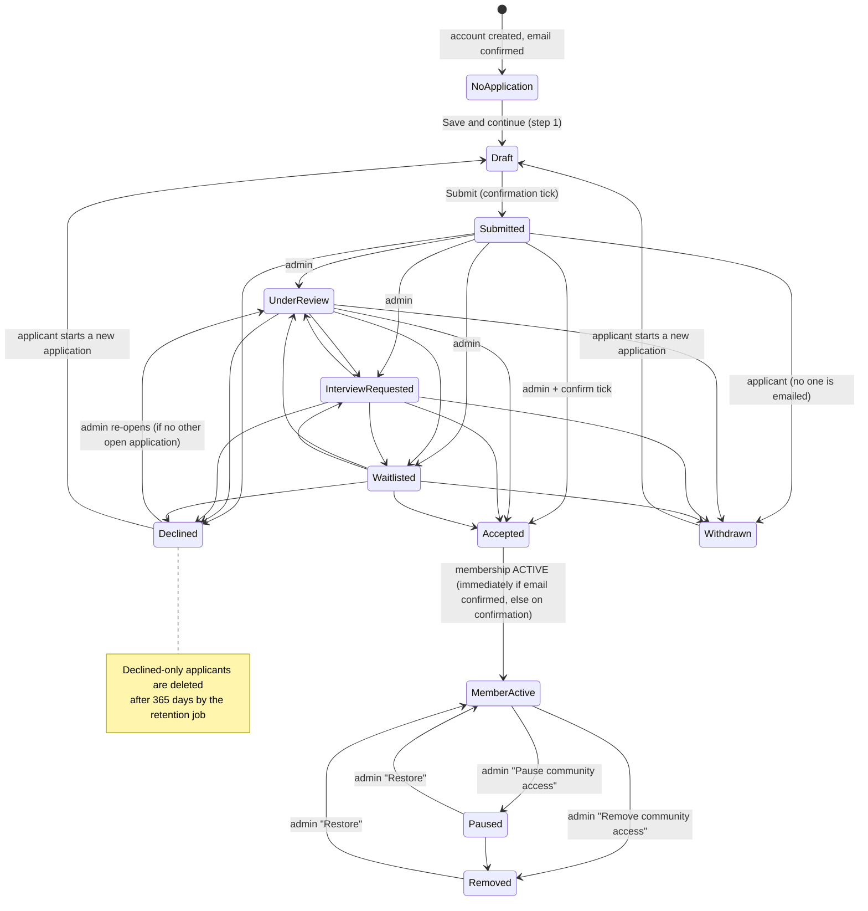

---

## 6. Member Dashboard and Community Experience

### 6.1 The gate

Every member page runs `requireMember()` (`src/lib/auth/guard.ts:89-95`, called by `src/app/community/(portal)/layout.tsx:17`): it requires community access (4.3), a display name, and current acceptance of any re-published Terms, Guidelines or Privacy Policy (otherwise redirect to `/legal/review`) [Source]. The `src/proxy.ts` file only checks that a session cookie exists; the real checks are on each page and action [Source].

### 6.2 What a newly approved member sees at first login

[Executed] The member lands on `/community`, titled **"Business Ideas"**: "Welcome, *full name*. Explore ideas, connect with other members, and discover opportunities to build something together", a note that supporting an idea accepts the Group Participation Agreement ("It creates no financial obligation"), a **Propose a Business Idea** button, search / category / sort controls and the idea cards. There is no separate dashboard, no checklist of first steps and no profile prompt (the welcome page is skipped, 5.5). On a wide screen (≥1,280 px) a right-hand column shows My Groups with unread counts, new groups to join and three unread notifications; on narrower screens only a "Your groups" strip appears, and only once the person belongs to a group (`src/app/community/(portal)/page.tsx:187`) [Source]. On a phone a bottom bar offers Ideas, Explore, My Groups [Executed].

### 6.3 Member pages [Source unless marked]

| Page | Purpose and data | Actions | Who | Database operations |
| --- | --- | --- | --- | --- |
| `/community` | Idea feed (OPEN and GROUP_FORMED ideas only), live-meeting banner for own groups, my groups, unread notifications [Executed] | Support from the card, search, filter, sort | Any member | Reads `BusinessIdea`, `IdeaEndorsement`, `GroupMembership` |
| `/community/ideas/new` | Idea form with a visibility warning | Publish | Any member | Creates `BusinessIdea` |
| `/community/ideas/[id]` | Idea, supporters, revision history, comments | Support / withdraw support; author: edit, close; others: report | Any member | Endorsements, comments, reports |
| `/community/ideas/[id]/edit` | Edit with "minor / material" choice | Save | Author | `IdeaRevision`, may delete endorsements |
| `/community/groups` | Explore groups (not suspended or archived by default) | Join | Any member | `GroupMembership` |
| `/community/groups/mine` | My active groups with unread counts, "meeting now" | — | Self | Reads |
| `/community/groups/[slug]` | Overview: purpose, next tasks (members only), latest announcement, stage, members [Executed] | Join / leave; coordinator tools; report group | Any member can view | — |
| `…/chat` | Live chat (Section 9) [Executed] | Send, edit, delete own, reply, attach | Group members | `ChatMessage`, `ChannelReadState` |
| `…/meetings` | Google Meet link sharing [Executed] | Start, join, end | Group members | `GroupMeeting`, `MeetingAttendance` |
| `…/research` | Notes, tasks, decisions, links, files | Add, edit, delete | Group members | `ResearchNote`, `ResearchTask`, `GroupDecision`, `GroupLink`, `StoredFile` |
| `…/discussions` | Announcements and threads | Start, reply, delete own, report | **Any member**, including non-members of the group | `GroupDiscussion`, `Comment` |
| `…/members` | Member list | Coordinator: make coordinator, remove | Any member can view | `GroupMembership` |
| `…/projects` | Group projects and agreements (Section 10) | Create, draft, open, accept, decline, activate, close | Group members | `GroupProject`, `ProjectAgreement*` |
| `/community/members/[id]` | A member's profile, groups and open ideas | Report profile | Any member | — |
| `/community/notifications` | Notification list | Mark read, mark all read | Self | `Notification` |
| `/community/profile` | Edit profile and photo (photo ≤5 MB) | Save, upload, remove | Self | `MemberProfile`, `StoredFile` |
| `/community/help` | How it works and FAQ | — | Any member | — |
| `/account/*` | Settings, security (sessions, two-step), notifications preferences, agreements accepted, personal data export, privacy requests, close account | Various; sensitive ones need re-entering the password within 10 minutes | Any signed-in account (even unverified) | Various |

### 6.4 Limits [Source]

- Ideas: 10 per author per 24 hours. Discussions: 10 per hour. Uploads: 30 per hour; 10 MB default (`MAX_UPLOAD_MB`). Chat: 20 messages per 10 seconds, 4,000 characters, 5 attachments. Reports: 20 per day. All counters are in process memory.

### 6.5 Is it understandable to non-technical users?

Mostly, with gaps [Inferred from Executed walk-through and Source]: the wording is plain and warm, and status messages are clear ("Your support was the last one needed…"). The main gaps for a newcomer are: no first-steps guidance on the first screen; no explanation of what "Support" commits them to beyond a one-line legal note; the "My Groups" side panel is hidden on laptops narrower than 1,280 px; two different "Projects" concepts (Section 10); and the "Research" tab name, which suits a study group better than a business team.

---

## 7. Business Idea Submission and Development

### 7.1 Submission [Source]

- **Who:** any member with community access (including staff). No limit on the number of ideas apart from 10 per 24 hours.
- **Required:** title (5–120 characters), summary (20–500), category (one of 10: Software & technology, AI & data, Online services, Content & media, E-commerce & products, Local & in-person services, Consulting & research, Education & training, Marketing & sales, Other), and a tick acknowledging that the idea is visible to all members.
- **Optional:** description (≤10,000), problem, proposal, customers, revenue model, skills needed, time estimate, expected activities, objectives, collaboration approach, up to 10 links (`src/lib/validation/community.ts:42-62`).
- **Visibility:** all members and staff. Not public.

### 7.2 Editing, closing and moderation [Source]

- Only the author edits. Every edit is stored as an `IdeaRevision` (full previous text) and shown to all members.
- If the idea has supporters and no group, the author chooses "minor" (support kept) or "material" (all support removed; supporters asked again). A category change is always material. Supporters are notified either way. The choice is the author's own declaration. Test "a material change resets the support and asks the supporters again" passed [Executed].
- Once a group exists, only minor edits are allowed.
- **Close:** the author can close an OPEN idea that has no group. There is no reopen. **Closed ideas disappear from every list** (the feed and profiles show only OPEN and GROUP_FORMED), although the confirmation says "It stays visible" (`ideas/[id]/page.tsx:149`); there is no "My ideas" page, so the author can find it only by its address.
- **No delete** by the author.
- **Administrators** can Remove (status REMOVED) and Restore ideas (`/admin/ideas`, or from a report). The author and supporters are **not notified**. If the idea already has a group, the group continues but its "Started from the idea" link leads to a "not found" page.
- Comments: threaded three levels deep, editable (no history) and deletable by their author.

### 7.3 Support votes

- **Meaning:** "you would like to investigate the idea with others". Supporting also records acceptance of the Group Participation Agreement, because a supporter may become a founding member of the group (`src/app/community/actions.ts:160`) [Source].
- **No duplicates:** the database key is (idea, user); repeated clicks are ignored (`prisma/schema.prisma:817`) [Source].
- **Not on one's own idea:** "You cannot support your own idea." (`src/server/community/ideas.ts:297`) [Source].
- **Reversible:** "Withdraw my support" while the idea is OPEN (`ideas.ts:328-338`). Withdrawing after a group formed does not dissolve the group or remove the supporter from it [Source]; test "withdrawing before creation lowers the count; after creation the group stays" passed [Executed].

### 7.4 Does "two supporters create a group" really work? — **Yes, VERIFIED.**

- **Rule in code** (`src/server/community/ideas.ts:233-246`, `evaluateIdea`): count the supporters of the idea who are active members right now, **excluding the author**; if the idea is OPEN and the count reaches the threshold, and no group exists yet, create the group. The threshold is the owner setting `community.endorsementThreshold`, **default 2**, range 1–50 (`src/config/org-settings.ts:11-16`), cached for 60 seconds. Lowering it in settings immediately creates groups for ideas that already qualify (`src/server/settings.ts:44-48`) [Source].
- **Race safety:** the idea row is locked (`SELECT … FOR UPDATE`, `ideas.ts:291-292`) and `ResearchGroup.ideaId` is unique, so only one group can ever be created per idea [Source]. Test "simultaneous endorsements create exactly one group" passed; "uses the configured threshold" passed; "lowering the threshold creates groups for ideas that already have enough support, and says how many" passed [Executed].
- **Live check** [Executed]: the demo idea "Evening tutoring…" had 1 supporter; one more support created the group immediately, with the author as Coordinator and both supporters as founding members.
- **Details** [Source]: staff support counts; suspended or paused supporters stop counting (the number is recalculated when anyone's status changes). The idea page lists *all* supporters, including ones who no longer count, next to a counter that excludes them, so members may see three names next to "1 of 2" (`ideas/[id]/page.tsx:53,183,227-240`).
- **Defect** [Source]: if the author is no longer active when the threshold is reached, the oldest supporter becomes coordinator but receives the message meant for the author ("Your idea … has attracted enough support … You coordinate the group") (`src/server/community/groups.ts:67`, `ideas.ts:251-260`).
- The author's own acceptance of the Group Participation Agreement is not recorded when their idea forms a group (only supporters and joiners are recorded) [Source].

### 7.5 Statuses and flow

`IdeaStatus` = `OPEN`, `GROUP_FORMED`, `CLOSED`, `REMOVED` (`prisma/schema.prisma:625-630`).

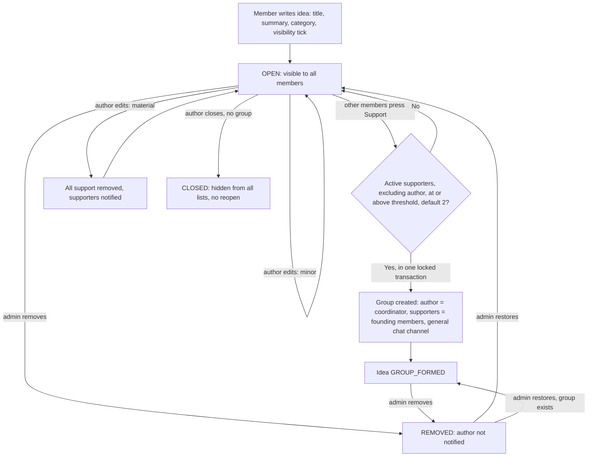

---

## 8. Collaborative Group System

### 8.1 Creation and settings [Source]

- **Only automatically** from an idea (7.4). Neither members nor administrators can create a group by hand.
- **Initial coordinator:** the idea's author if active; otherwise the earliest eligible supporter.
- **Link to the idea:** `ResearchGroup.ideaId` (unique). Name, purpose, description and category are copied from the idea.
- **Edits:** only the coordinator. Changing the purpose requires a reason of at least 10 characters and creates a recorded decision, an announcement, a chat line and a notification (audited `group.purpose_changed`). Name and description changes are silent and not audited (`groups.ts:451-487`).

### 8.2 Discovery, joining, leaving [Source; joining Executed]

- **Discovery:** Explore Groups lists groups that are not suspended or archived; any member can read a group's overview, member list, announcements and discussions. Chat, meetings, research and projects show "For group members only". Suspended groups return "not found" to non-members.
- **Joining:** open to any member, one click, **no approval and no size limit** (`joinGroup`, `groups.ts:194-227`); a chat line announces it; administrators are labelled "(administrator)"; acceptance of the Group Participation Agreement is recorded [Executed for the join].
- **Leaving:** any time; the person loses any project-coordinator role; a chat line is written; the live chat drops them.
- **Removal:** the coordinator can remove a member (a notification explains it). A removed person cannot rejoin until an administrator chooses "Allow to join again". Removed people still see "Join group" buttons, which then fail with an explanation.

### 8.3 Coordinator changes and groups without a coordinator [Source]

- The coordinator can hand over the role ("Make coordinator").
- When a coordinator leaves, is removed, paused or suspended, `ensureCoordinator` (`groups.ts:243-265`) promotes the longest-standing eligible member and tells the group. If no member is eligible, the group is flagged "administrators look after this group" (`adminManaged`); with zero active members it is **archived** automatically.
- A person whose access is restored comes back as an ordinary member; the coordinator role is not restored.
- An administrator can assign a coordinator.

### 8.4 Roles

`GroupRole` = `COORDINATOR`, `MEMBER`; `MembershipStatus` (group) = `ACTIVE`, `LEFT`, `REMOVED` (`prisma/schema.prisma:642-651`).

| Capability | Any member (not in group) | Group member | Coordinator |
| --- | --- | --- | --- |
| Read overview, members, announcements, discussions | Yes | Yes | Yes |
| Start or reply to a group discussion | **Yes** (no membership check, `comments.ts:147-154`) | Yes | Yes |
| Chat, meetings, research, files, projects | No | Yes | Yes |
| Edit any research note | No | **Yes** (any note) | Yes |
| Delete notes, tasks, links, files | No | Own only | Anyone's |
| Record a decision, add a task, change any task's status | No | Yes | Yes |
| End a meeting | No | Own, or anyone's after 60 minutes | Any |
| Edit group info, post announcements, set the stage, remove members, hand over the role | No | No | Yes |
| Delete other people's chat messages, discussions or comments | No | No | **No** |

Stages (`GroupStatus`): FORMING, RESEARCHING, VALIDATING, PLANNING, READY_FOR_REVIEW, APPROVED_FOR_PROJECT, ARCHIVED. The coordinator may move among the first five in any order; each change is audited and announced [Source].

### 8.5 Administrator access to private group content [Source]

| Content | Can administrators see it? | Audited? | Are members told? |
| --- | --- | --- | --- |
| Member list with **email addresses** | Yes, on the admin group page | No | No |
| Counts of notes, tasks, decisions, meetings, discussions | Yes | No | No |
| Plan, Concept, Revenue and Risks research notes | Yes, once the coordinator sets READY_FOR_REVIEW | **No** | Yes, in the stage-change notice ("Administrators can now read the research notes (not the chat)") |
| Chat | Not in the admin panel. Only the text of a reported message | Viewing reports with chat text: yes, at most once per hour per admin | The chat page says administrators see a message only if someone reports it |
| **Everything else after joining the group** | An administrator can join any open group like a member. They then see chat only from the moment they joined, **but all past research notes, tasks, decisions, links, group files and meeting history** | Only as an ordinary `group.member_joined` entry | The join appears in chat with "(administrator)" |

The admin page's statement "Private chat messages and files are not shown to administrators" is true for the admin panel only; joining the group bypasses the file part [Source]. Members are likely to assume more privacy than exists [Inferred].

### 8.6 Active, archived, suspended, reopened [Source]

- **Archive / suspend** (administrator, `adminSetGroupState`, `groups.ts:500-530`): ends live meetings; suspension also disconnects live chat. **Members receive no notification and no chat line.** No confirmation step on Archive and Reopen.
- **Reopen** always sets the stage back to FORMING, even for a group that was APPROVED_FOR_PROJECT and has a linked project [Source]; the coordinator could then move through the stages again while approval is refused because a project already exists [Inferred].
- **Suspension through a moderation report** sets the suspended flag directly, without disconnecting live chat or ending the meeting, unlike the admin-page suspension (`src/server/community/reports.ts:118-119`) [Source].
- **Approve for project** (OWNER only) on a READY_FOR_REVIEW group creates an *earlier-style* admin-run project record and moves the group to APPROVED_FOR_PROJECT (Section 10.1).

### 8.7 Concurrency and edge cases [Source]

- Database uniqueness: one membership per person per group, one group per idea, unique slugs, one "general" channel, **one active meeting per group** (partial unique index), idempotent chat messages.
- All membership changes run under a group row lock with retry on deadlock.
- Not locked: a coordinator's stage change and the owner's approval can race (small window) [Inferred]. Two ideas with identical titles forming at the same instant could collide on the group address and one would fail (very rare) [Inferred].
- An unknown admin action value on the group page falls into the "lift suspension" branch (`groups.ts:500-511`) — reachable only by a crafted request from an administrator [Source].

---

## 9. Communication and Collaboration Tools

### 9.1 Group chat — VERIFIED

| Question | Answer | Evidence |
| --- | --- | --- |
| Transport | Socket.IO (WebSocket, with HTTP long-polling fallback) on the same server process as the website, at `/socket.io` | `server.ts:120-131`, `src/realtime/server.ts`, `src/components/community/socket.ts:11` [Source]; message delivered live [Executed] |
| Persistence | PostgreSQL: `GroupChannel` (one "general" channel per group), `ChatMessage` (USER or SYSTEM) | `prisma/schema.prisma:941-984` [Source]; message found in the database [Executed] |
| History | 50 most recent on open, "Load earlier messages" 50 at a time. Members see the full history even if they joined later; **OWNER/ADMIN see only from when they joined** | `chat-service.ts:37-39,93-107` [Source] |
| Edit / delete | Authors only, no time limit; edits overwrite (marked "edited", no history); delete shows "Message deleted" and hides attachments | `chat-service.ts:180-196` [Source] |
| Unread | Per person, from the last read time; shown on My Groups, the feed and the Chat tab. **No notification or email for new chat messages** | `groups.ts:106-136` [Source] |
| Authorization | Every join, history load, send, edit and delete re-checks in the database that the person is an active member of a non-suspended group with community access; session validity is checked on every packet and every 60 seconds | `chat-service.ts:42-54`, `src/realtime/server.ts:158-167` [Source] |
| Sign-out | Ends the session; the server disconnects that session's sockets and the page reloads | `src/lib/auth/session.ts:72-80` [Source] |
| Suspension / access paused | All the person's sockets are disconnected; reconnection refused | `accounts.ts:327,365` [Source] |
| Leaving / removed | The person is dropped from the room and sees "You no longer have access to this chat" | `server.ts:278-290` [Source] |
| Session expiry | Detected on the next packet or within 60 s. The staff 60-minute idle rule is checked only on page loads, so an administrator who stays in chat keeps the socket [Inferred] | `session-core.ts:83-87` |
| Reliability | Unsent messages are kept in the browser and resent after a reconnect without duplicates | `chat.tsx` [Source] |
| Reporting a message | **No button in the chat interface**, although the server supports message reports and the chat page and help text say administrators see a message only if someone reports it | `src/components/community/chat.tsx` (no report control), `reports.ts:45-54` [Source] |
| Scale | Rate limits and presence are held in one process; one server instance only (enforced) | Section 15 |

### 9.2 Voice and video

**There is no native voice or video.** Meetings are **external Google Meet links** (`src/server/community/meetings.ts:9-18`) [Source; page Executed]:
1. A group member opens Google Meet in a new tab and creates a meeting.
2. They paste the link (must match `https://meet.google.com/xxx-xxxx-xxx`), add an optional topic and press **Start Meeting**. All group members are notified.
3. Others press **Join Meeting**, which records attendance and opens the Meet link.
4. One active meeting per group (database-enforced). Meetings end when the starter or coordinator ends them, when anyone ends them after 60 minutes, or automatically after 4 hours (hourly job).

Nothing is recorded; audio and video never pass through Twigo. Anyone who obtains the Meet link can ask Google Meet to let them in; the page says so.

### 9.3 Research workspace, discussions and files [Source]

| Tool | Behavior | Limits |
| --- | --- | --- |
| Research notes | Nine sections (e.g. Plan, Concept, Revenue, Risks). Any group member can edit any note | No version history; last save wins; the last editor is stored but not shown; one-click delete without confirmation, not audited |
| Tasks | To do / In progress / Done; optional assignee (active member) | **Assignee is not notified**; no due dates or reminders; any member can change any task's status |
| Decisions | Any member records one; all members are notified | Cannot be edited or deleted; **no voting mechanism** |
| Links | http(s) links | Removed by the adder or the coordinator |
| Files | Upload via `POST /api/files`, type detected from file content (PNG, JPEG, GIF, WebP, PDF, Word/Excel/PowerPoint, TXT/CSV/MD); images re-encoded to WebP (removes location data) except GIF; stored on the server disk (`STORAGE_DIR`); downloaded via `GET /api/files/[id]` only by active group members; non-images always download as attachments | 10 MB default; 30 uploads per hour. No virus scanning; files not encrypted on disk. Deleting a group file removes its bytes immediately. Test "rejects disguised files and uploads by non-members; downloads are member-only" passed [Executed] |
| Discussions | Threads open to **all members**, not just the group (the page warns) | No editing; author delete without confirmation; coordinators cannot moderate |
| Announcements | Coordinator only; members notified | No edit or delete |
| Shared documents | **None** — no co-editing of documents beyond the notes above |
| Activity history | No activity feed. History exists as chat system lines (joins, leaves, removals, coordinator changes, purpose changes), idea revisions and the decision list; administrators have the audit log |

### 9.4 Notifications [Source]

In-app notifications with a live badge, plus email per notification type, chosen at `/account/notifications`. Email is **on by default** for: group created from your idea, group membership, coordinator assigned, administrator message, idea changed, project agreement. Repeated notifications are merged. Emails go through the `community_notification` template and therefore only work when email works (Section 13); today they were captured locally [Executed]. A "group updated" live event is sent by the server but no page listens for it, so group pages do not refresh by themselves.

---

## 10. Projects and Agreements

There are **two separate project systems** in the code [Source].

### 10.1 Earlier admin-run projects ("Earlier project records")

- **Models:** `Project`, `ProjectRole`, `ProjectAssignment`, `ProjectMilestone`, `CompensationAgreement` (`prisma/schema.prisma:460-570`); code in `src/server/admin/projects.ts`.
- **Who:** both ADMIN and OWNER (`projects.manage`); compensation records OWNER only. (The implementation report describes this module as owner-only; that is inaccurate for projects.)
- **Statuses:** PLANNING, SEEKING_PARTICIPANTS, READY, ACTIVE, COMPLETED, CANCELLED, chosen freely from a dropdown with no rules.
- **Assignments** of accepted applicants (Participants) to roles; **milestones** (Pending / In progress / Done) give a progress percentage.
- **Compensation:** the owner writes the terms and sets the status (Draft, Agreed in writing, Settled, Void) by hand; **participants do not accept anything in the software**. Projects with compensation records cannot be deleted (database-enforced).
- **Public effect:** projects marked as published appear as "Current opportunities" on `/participation`.
- **Link to groups:** the OWNER's "Approve for project planning" on a READY_FOR_REVIEW group creates a project in this system, not in the member-led system.
- The project's documents call it "kept for history" and its retirement an open decision [Docs]; it remains fully editable [Source].

### 10.2 Member-led group projects (the Twigo model)

**Creation and status** [Source; tests passed]:
- Any active member of an open group creates a project (name 3–120, objective 10–2,000) and becomes **project coordinator**. No administrator approval.
- `GroupProjectStatus`: PLANNING → AGREEMENT_PENDING ("Agreement waiting for acceptance") → ACTIVE ("Commercially active") → COMPLETED or CANCELLED (with a closing note of ≥10 characters). Closed projects are final; there is no reopen.
- Editing rights: the group coordinator or the project coordinator.
- **Responsibilities** exist only as free text per participant inside an agreement (role, responsibilities, expected contribution, compensation). **Projects have no tasks, milestones, progress or decisions of their own**; the group's research tools are not linked to a project.

**Agreements** (`src/server/community/group-projects.ts`) [Source; tests passed]:

| Step | Behavior |
| --- | --- |
| Draft | Editors fill a structured form: scope, deliverables, timeline, customer, contracting model (Undecided / project representative / direct contracts / separate entity / other), contracting details, **payment recipient**, approved expenses, gross revenue, deductions, refunds and chargebacks, net revenue, compensation method (equal / contribution / role / fixed / other), distribution formula, payment schedule, IP, confidentiality, withdrawal, disputes, and per participant: role, responsibilities, expected contribution, compensation. **Every money item is free text.** The generated text always includes "the platform is not a party… receives no share, commission or fee" and "Leaving the project does not by itself forfeit compensation already earned". Drafts are visible to the whole group and not binding. At most 50 participants. |
| Open for acceptance | Refused until the contracting model is chosen, 12 required items are filled, there is at least one participant, and each participant has responsibilities and compensation text. The text is then frozen and fingerprinted (SHA-256). Listed participants are notified. |
| Accept | Each listed participant ticks a confirmation; acceptance is bound to the fingerprint. When the last one accepts, the version becomes ACCEPTED and the previous accepted version becomes SUPERSEDED. |
| Decline | Recorded with a note; the person can still accept later. |
| Withdraw (an open version) | Editors only; the version in force is unaffected. |
| History | All versions listed with status and fingerprint; nothing is ever deleted (database RESTRICT). Immutability after drafting is enforced in application code, not by a database trigger. |
| Download | `GET /api/agreements/[id]`: group members, listed participants (even after leaving the group, if they still have community access), and the OWNER with two-step verification (audited). Drafts are never downloadable. Markdown file with acceptance timestamps. |
| Leave a project | A participant of the accepted version records withdrawal (note ≥10 characters); others are notified; the agreement is not changed. |

**Is acceptance required before work starts?** Within the software, **yes**: `activateProject` (the "Start commercial work" button) refuses unless the newest version is ACCEPTED by every listed participant, a contracting model and payment recipient are set, and the "needs legal review" flag is clear [Source]. "Commercially active" is only a label: nothing in the software can stop or detect work or payments outside it [Inferred].

**Gaps** [Source unless marked]:
- After everyone accepts, the status stays "Agreement waiting for acceptance" until a coordinator presses "Start commercial work".
- Setting "needs legal review" after activation does not deactivate the project; closing a project does not withdraw an open version; a draft cannot be deleted, and an existing draft blocks activation until it is opened and withdrawn.
- **Omission gap:** an editor chooses who is listed in each new version, and only those listed must accept. A coordinator can therefore draft a new version that leaves someone out; when the remaining participants accept, the earlier version (which included that person) is superseded without that person's acceptance. This contradicts the policy statement "Nobody, including the coordinator, can change another person's compensation without that person's acceptance" (`src/content/legal/policies.ts`, "Changes"). No test covers this case [Source]. (A person who has left the group must be dropped, because non-members cannot be listed.)
- **Every group member** (not only participants) can read every version, including drafts and everyone's compensation terms.
- The form's numbering differs from the section numbering in the generated agreement text.

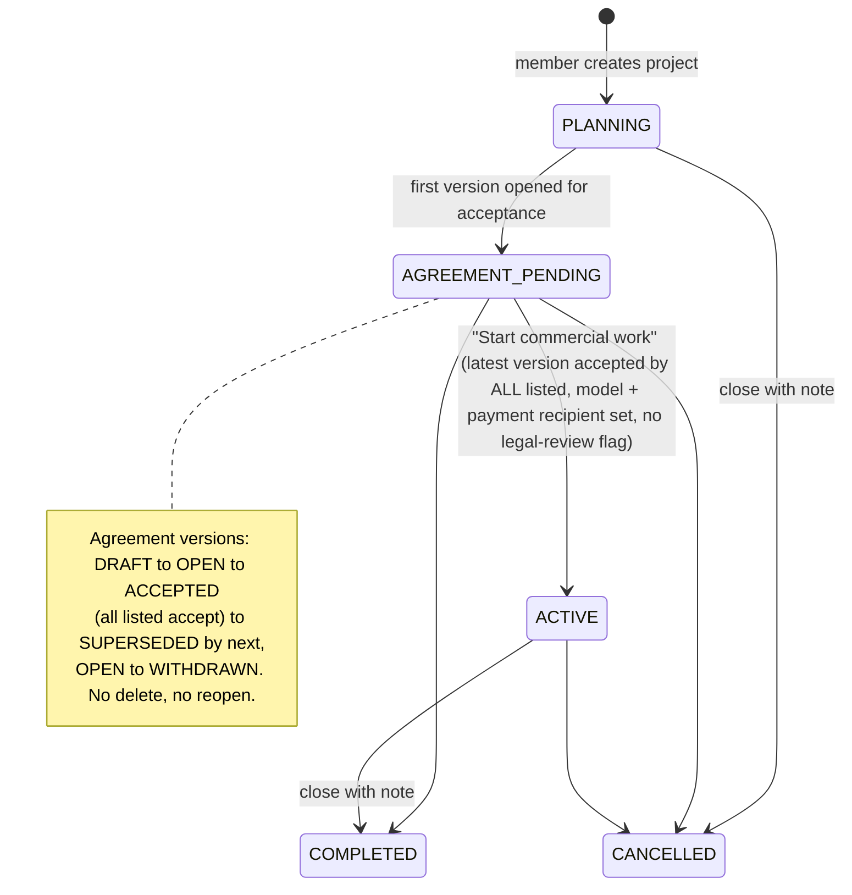

---

## 11. Compensation and Member-Led Revenue Distribution

### 11.1 Intended principles and where they live

| Principle | Implemented in software? | Evidence |
| --- | --- | --- |
| No automatic platform commission | **Yes, by absence**: no commission, fee or percentage is calculated, stored or deducted anywhere; the agreement text states the platform takes nothing | Code search; test file `tests/twigo-revenue-model.test.ts` (12 tests) passed [Executed] |
| Members set their own splits based on contribution | **Partly**: a compensation method and free-text formula and per-person terms; no amounts, percentages, totals or check that shares add up | `group-projects.ts:36-42,76-77,92` [Source] |
| Voluntary community contribution | **Records only**: the owner can record entries and publish frozen totals; nobody can contribute online | Section 11.4 |
| No fees or mandatory investment | **Yes, by absence**: no payment code or provider exists; the application confirmation says "I will never be asked to pay" | `package.json` (no payment library) [Source] |
| No guaranteed income | **Text only** (footer, application confirmation, Pay & Fairness "what we do not promise") | [Source] |

### 11.2 Questions and answers

| Question | Answer |
| --- | --- |
| Is there a compensation agreement system? | **Yes, two**: member-accepted project agreements (10.2) and owner-written records in the earlier module (10.1) |
| Can members define their own splits? | **Partly** — as free text inside the agreement, accepted by every listed participant |
| Are contributions recorded? | **No.** Only an "expected contribution" text per person. Nothing records actual work, hours or deliverables |
| Are compensation records private? | **No, not within the group**: every group member sees all versions and all terms. Not visible to other members or the public |
| Can members view their terms? | Yes (group projects). For the earlier module, only through their personal data export |
| Do administrators have access? | ADMIN sees project names, status and "x of y accepted", **not** terms. OWNER can download any agreement (with two-step verification, audited) and sees the earlier module's compensation records (viewing those is not audited). No administrator can edit a member agreement |
| Is there an audit log? | Yes for agreement actions (created, drafted, opened, accepted, declined, withdrawn, activated, closed, owner download). Audit writing is best-effort (a failure is logged, not blocking) |
| Is a voluntary community contribution possible? | Only recorded manually by the owner; online payment impossible (`paymentsAvailable()` hard-coded `false`, `src/server/community-support.ts:26-28`) |
| Is any commission calculated or deducted? | **No** [Source; Executed by tests] |
| Are there real payments or transfers? | **No.** No payment provider, payout or transfer code exists |
| Is external revenue tracked? | **No.** "Gross / net revenue" are text definitions inside agreements. `docs/FINANCIAL-TRANSPARENCY.md` describes revenue and distribution tracking as "(not implemented)" |

### 11.3 What is principle only

These appear on public pages or in policies but have no software support [Source]: disclosure of a project's revenue and expenses to its participants; "paid after the customer pays"; refund and late-payment handling; dispute and mediation procedures; tax treatment; receipts. Where page text says "commercial work starts only after every participant accepted", the software enforces only its own status label.

### 11.4 Community Support [Source]

- The OWNER (only) records ledger entries: Contribution, Operating expense, Development expense, Other expense; positive amounts up to 20,000,000.00; a currency; an optional private contributor name. Entries cannot be edited or deleted, and a mistake cannot be reversed with a negative entry.
- The OWNER creates a report for a period and one currency, then publishes it. Totals are calculated once and frozen; entries in other currencies are silently left out; a published report cannot be withdrawn.
- `SUPPORT_PAYMENTS_ENABLED` only displays a switch state on the owner page; it cannot enable anything.
- Public `/support` says "No support has been received and no report has been published yet." whenever **no report is published**, even if contributions have been recorded — this sentence could become false (`src/app/(site)/support/page.tsx:63`).
- Support records are linked to no account or project; tests confirm the separation [Executed].

---

## 12. Administration and Organization Management

### 12.1 How authorization is enforced [Source]

- Roles: `UserRole` = OWNER, ADMIN, MEMBER. Permissions are listed in `src/lib/auth/permissions.ts`: OWNER has every permission; ADMIN has 16; MEMBER none.
- `requireAdmin(permission)` (`src/lib/auth/guard.ts:50-57`) checks, in order: signed in and active with no pending code → staff role → two-step verification enrolled (else sent to set it up) → the permission (else `/admin/no-access`).
- All 50 admin server actions and the three admin download routes call `requireAdmin` first. **No admin action or route without an authorization check was found.**
- Only the OWNER may act on OWNER or ADMIN accounts; nobody can act on their own account in the admin area; the last active OWNER cannot be deactivated or demoted.
- Re-entering the password within the last 10 minutes is required for: role changes, inviting an administrator, saving settings and running retention. It is **not** required for several irreversible owner actions: legal publication, applicant erasure, participant removal, project deletion, compensation removal, the applications CSV export and applicant data export.
- Tests `corrective-admin.test.ts` and others passed [Executed]. The OWNER path was exercised in the browser [Executed]; an ADMIN account was not.

### 12.2 Admin pages and actions [Source]

| Page | Who | What it can change | Logged | Notifies | Reversible |
| --- | --- | --- | --- | --- | --- |
| Overview `/admin` | ADMIN, OWNER | Nothing (counts, waiting list, "Before launch" list) [Executed] | — | — | — |
| Applications, application detail | ADMIN, OWNER | Status, notes, approve (also `members.invite`), free-text email to applicant | Yes | Applicant, only if "notify" ticked | Status yes; acceptance no |
| Applications CSV export; applicant JSON export | OWNER | — (download of personal data) | Yes | — | — |
| Delete applicant data | OWNER (typed DELETE); the panel is shown to ADMINs too, who are then refused | Deletes applicant and applications, not the user account | Yes | No | **No** |
| Members, member detail | ADMIN (MEMBER targets only), OWNER | Suspend, reactivate, deactivate; pause / remove / restore community access; send an in-app message | Yes (the suspension reason is not stored in the log) | Suspend: **no**; access change: optional email; message: in-app | Yes, except group memberships ended by removal or deactivation are not restored |
| Administrators | OWNER | Invite administrator, change roles (password re-entry) | Yes | Invitation email; role change: no | Yes |
| Moderation (reports) | ADMIN, OWNER | Dismiss; remove content; remove and suspend author | Yes; viewing reported chat text logged once per hour | **Author never notified** | Removed comments, discussions and chat messages cannot be restored; ideas can |
| Ideas | ADMIN, OWNER | Remove, restore | Yes | No | Yes |
| Project groups, group detail | ADMIN, OWNER (approve: OWNER) | Archive, reopen (always to FORMING), suspend (reason required), lift suspension, assign coordinator, allow a removed member to rejoin, approve for project | Yes | Coordinator assignment and rejoin: yes; archive and suspend: **no** | Mostly; reopen loses the previous stage |
| Project agreements | ADMIN (status only), OWNER (plus earlier compensation records) | Nothing for member agreements | Owner downloads | — | — |
| Earlier project records, participants | ADMIN, OWNER (delete/remove/compensation: OWNER) | Projects, roles, milestones, assignments, publication; compensation | Yes | No | Delete and removal: **no** |
| Community support | OWNER | Ledger entries, reports, publish | Yes (no amounts in the log) | — | **No** (no edit, delete or unpublish) |
| Customer inquiries | ADMIN, OWNER | Status | Yes | No | Yes |
| Email | ADMIN, OWNER (templates: OWNER) | Retry, check connection, test email to self, edit templates | Retry, connection check and templates: yes; test emails: **no** | — | Templates can be reset |
| Website content | ADMIN, OWNER | Public content including the **public contact email** and announcement | Yes | No | Yes (reset) |
| Settings | OWNER (password re-entry) | Support threshold, retention periods, other organization settings | Yes (before and after) | No | Lowering the threshold creates groups **immediately and irreversibly** |
| Legal (documents, notices, acceptances) | OWNER | Draft, submit for review, approve (reviewer note ≥10 characters plus a tick), publish; legal notices | Yes | **Members are not notified of a new version**; they meet the re-acceptance page on their next visit | No un-publish; only a newer version |
| Privacy & data (retention) | Preview: ADMIN, OWNER; run: OWNER (password re-entry, typed DELETE) | Deletes data per retention rules | Yes | No | **No** (only from backup) |
| Privacy requests | OWNER | Status and response | Yes | **The requester is not notified**; they must check `/account/data` | Yes |
| Backups | OWNER | "Back up now"; list files and job history; **no download** | Only on success | No | — |
| Audit log | ADMIN, OWNER | Nothing (read-only view of the whole log, including the owner's actions) | — | — | — |

**Defects** [Source]:
- "Remove and suspend author" in moderation silently fails to suspend when the author is staff, yet reports success (`reports.ts:92-135`).
- The idea moderation action accepts any action value; an unknown value changes nothing but logs `idea.<value>` and shows "Idea restored." (`src/app/admin/actions/community.ts:106-118`).
- Reads of personal data by administrators (applications, members, inquiries, email log) are not audited.

### 12.3 OWNER vs ADMIN vs coordinator vs member

- **OWNER** = ADMIN plus: personal-data exports and erasure, participant removal and project deletion, compensation records, approving groups for projects, email templates, retention runs, backups, organization settings, administrator management, legal documents and notices, Community Support, and privacy requests.
- **ADMIN** = review and accept applications; manage members (MEMBER accounts only); moderate; manage groups (except approval); see project-agreement status (not terms); run the earlier project module; send and retry email; edit public website content; handle inquiries; read the audit log; preview retention.
- **Coordinator** = a group role, not an organization role: edit the group, announcements, stage, remove members, hand over the role, delete others' notes/tasks/links/files, end meetings, and (with the project coordinator) edit project agreements. No admin rights.
- **Member** = everything in the community that is not coordinator-only; no admin rights.
- Staff (OWNER, ADMIN) also have full community access without applying, and can join any group.

### 12.4 Role–permission matrix [Source]

"Applicant" = signed in, email confirmed, not yet accepted. "Y (staff)" = staff can do it as community users.

| Capability | Visitor | Applicant | Member | Group member | Coordinator | ADMIN | OWNER |
| --- | --- | --- | --- | --- | --- | --- | --- |
| Read public pages and policies | Y | Y | Y | Y | Y | Y | Y |
| Sign up, contact form, password reset | Y | – | – | – | – | – | – |
| Fill in and submit an application | – | Y | – | – | – | – | – |
| Account settings, sessions, own data export, privacy request, close own account | – | Y | Y | Y | Y | Y | Y (not the last owner) |
| Turn off own two-step verification | – | Y | Y | Y | Y | N | N |
| Browse, create, support and comment on ideas; report content; join groups | – | – | Y | Y | Y | Y (staff) | Y (staff) |
| Start or reply to group discussions | – | – | Y | Y | Y | Y (staff) | Y (staff) |
| Group chat, meetings, research, files; create a group project | – | – | – | Y | Y | if joined | if joined |
| Edit group info, announcements, stage; remove members; hand over role; delete others' research items | – | – | – | – | Y | only as coordinator | only as coordinator |
| Edit project agreements | – | – | – | project coordinator only | Y | as coordinator | as coordinator |
| Open the admin panel (two-step required) | – | – | – | – | – | Y | Y |
| Review and accept applications | – | – | – | – | – | Y | Y |
| Export or erase applicant data | – | – | – | – | – | N | Y |
| Suspend / restore accounts and community access | – | – | – | – | – | Y (members only) | Y (anyone but self) |
| Moderate reports and ideas | – | – | – | – | – | Y | Y |
| Archive, suspend, reopen groups; assign coordinator | – | – | – | – | – | Y | Y |
| Approve a group for project | – | – | – | – | – | N | Y |
| See project agreement status | – | – | – | own group (full terms) | own group (full terms) | Y (no terms) | Y (+ download terms, audited) |
| Earlier project records (edit) | – | – | – | – | – | Y | Y |
| Delete projects, remove participants, compensation records | – | – | – | – | – | N | Y |
| Send, retry email; test connection | – | – | – | – | – | Y | Y |
| Edit email templates | – | – | – | – | – | N | Y |
| Edit public website content | – | – | – | – | – | Y | Y |
| Organization settings, retention run, backups | – | – | – | – | – | N | Y |
| Legal documents and notices | – | – | – | – | – | N | Y |
| Community Support ledger | – | – | – | – | – | N | Y |
| Handle privacy requests | – | – | – | – | – | N | Y |
| Read the audit log | – | – | – | – | – | Y | Y |
| Manage administrators | – | – | – | – | – | N | Y |
| Create an owner, reset two-step, publish reviewed legal texts | Server command line only (`npm run admin:create`, `npm run legal:publish-reviewed`) — not an app role | | | | | | |

---

## 13. Email and External Integrations

### 13.1 How email is sent [Source]

- One transport: Nodemailer over SMTP (`src/lib/email/index.ts:77-91`). Resend is used **only as an SMTP relay** (intended `smtp.resend.com`, port 465, TLS, user `resend`, the API key as password). No Resend API client is installed.
- Plain-text messages only (no HTML).
- Every message carries an `X-Delivery-Id` header linking it to its `EmailDelivery` row.
- **Development:** all mail goes to a local capture server on `127.0.0.1:2525` with a web inbox on port 8025 and is recorded as `CAPTURED_LOCALLY` [Executed].
- **Production start-up** requires `SMTP_HOST` and `EMAIL_FROM` but **not** `SMTP_PASSWORD`: with no key the server starts, logs a warning, and every email is recorded as "not configured". The deployment script, by contrast, refuses to deploy without `SMTP_PASSWORD` (`scripts/deploy/deploy-twigo.sh:287`).
- Most emails are sent while the user's request waits; an unreachable mail server can delay a page by up to the 10-second connection timeout [Inferred].

### 13.2 Every email type [Source]

| Template | Sent when | Condition |
| --- | --- | --- |
| `account_verification` | Sign-up, resend | Always |
| `account_exists` | Sign-up with an already registered address | Always |
| `application_received` | Application submitted | `SEND_APPLICANT_CONFIRMATION` not false (default on) |
| `admin_new_application` | Application submitted | Only if `ADMIN_NOTIFICATION_EMAIL` is set |
| `admin_new_inquiry` | Contact form | Only if `ADMIN_NOTIFICATION_EMAIL` is set |
| `interview_invitation`, `application_waitlisted`, `application_declined`, `application_accepted` | Admin status change | Only if the admin ticks "notify" / "Approve and Notify" |
| `create_account_request` | Admin asks a legacy applicant without an account to register | Manual |
| `account_invitation` | Owner invites an administrator; legacy member invitation | Manual |
| `password_reset` | Forgot password | Active accounts with a password |
| `email_verification` | Member changes email address | Always |
| `membership_status` | Community access paused, removed or restored | Only if the admin ticks "notify" |
| `community_notification` | Community notifications | Per member preference; several types on by default |
| Test email; template test | Admin → Email | Manual (the template test sends unfilled `{{placeholders}}`) |

All templates can be edited by the OWNER and are stored in `EmailTemplate`.

### 13.3 Delivery states [Source]

`EmailStatus` (`prisma/schema.prisma:728-739`), recorded per email in `EmailDelivery`:

| Situation | Status | Meaning |
| --- | --- | --- |
| Not configured | `NOT_CONFIGURED` | No sender, no host, or the Resend key missing; no connection attempted |
| Rejected or failed at SMTP | `SERVER_UNAVAILABLE`, `AUTH_FAILED`, `SENDER_REJECTED`, `RECIPIENT_REJECTED`, `FAILED` | Classified from the SMTP error; nothing left the server |
| Accepted by the provider | `ACCEPTED` | SMTP "250 OK"; labelled "Accepted by provider (delivery not confirmed)" |
| Confirmed delivered | `DELIVERED` | Set **only** by a verified webhook |
| Failed after acceptance | `DELIVERY_FAILED` | Set **only** by a verified webhook (bounce or failure) |
| Local test | `CAPTURED_LOCALLY` | Development only [Executed] |

The system never reports an email as delivered merely because it was handed to the provider [Source; test "acceptance is never presented as inbox delivery…" passed, Executed].

### 13.4 Retry and webhooks [Source]

- **Retry is manual only**: an administrator presses Retry on a failed row (with a confirmation tick). The retry is a new row; secret links (verification, invitation, reset) get fresh tokens. **There is no automatic retry and no email job.** If the mail service is briefly down, failed emails stay failed until someone retries each one.
- **Webhook** `POST /api/email/webhook`: disabled (404) unless `RESEND_WEBHOOK_SECRET` is set; Svix-style HMAC signature checked by hand-written code, ±5 minutes; `email.delivered` → DELIVERED, `email.bounced`/`email.failed` → DELIVERY_FAILED. Test "verifies webhook signatures and refuses forged or old ones" passed [Executed].
- **Matching risk (UNKNOWN):** a webhook event is matched to an email by the `X-Delivery-Id` header (if Resend echoes headers in the event) or by the provider's message id. The stored id is the Message-ID that Nodemailer generated, not Resend's own email id. Whether real Resend events will ever match is untested; the project's own report says it was tested only with simulated events (`docs/EMAIL-FIX-REPORT.md:105`) [Docs]. If they do not match, every email stays at "Accepted by provider" forever.

### 13.5 Sender verification [Source; Docs]

The code checks only that `EMAIL_FROM` is a valid address. Domain verification (SPF/DKIM) for twigo.space is stated in `.env.example` as done in Resend, while `docs/EMAIL.md` still says the domain is not chosen. Nothing in the repository proves verification [Docs].

### 13.6 Integrations tested with real accounts

| Integration | Real-account test | Evidence |
| --- | --- | --- |
| Resend SMTP delivery | **Never** | Key empty by design; release report lists real delivery as pending [Docs] |
| Resend webhook | **Never** | Simulated events only [Docs] |
| Cloudflare DNS / proxy | Observed from outside only: domain resolves to Cloudflare; HTTPS returned error 525 on 23 Nov | [Docs] |
| Central Caddy on the VPS | **Never inspected or configured** | No VPS access during development [Docs] |
| Google Meet | Links only; no API | [Source] |
| Payments | None exist | [Source] |

No secrets were read or recorded for this report; the local `.env` contains a variable named `SMTP_PASSWORD`, whose value was not read.

---

## 14. Legal, Privacy and Security

### 14.1 Legal documents

- **Eight documents** (`src/content/legal/index.ts`): Terms of Use and Community Guidelines (accepted at sign-up), Privacy Policy (acknowledged at sign-up, "not a consent"), Group Participation Agreement (accepted when supporting an idea or joining a group), and four informational policies: Intellectual Property, Participation & Compensation, Cookies, Community Support [Source].
- **States:** `DRAFT`, `PENDING_LEGAL_REVIEW`, `APPROVED`, `PUBLISHED`, `SUPERSEDED`. Version 1 of each document is created automatically, on first use, as `PENDING_LEGAL_REVIEW` with the note "Not reviewed by a lawyer" (`src/server/legal.ts:36-69`). The public sees the latest published version, or, if none, the latest approved or pending one (`legal.ts:71-83`) [Source].
- **Approval** in the app requires a reviewer note and a tick; publication supersedes earlier versions; there is no un-publish. A server command (`npm run legal:publish-reviewed`, also offered by the deployment script only when the operator types `PUBLISH`) marks exact-fingerprint texts approved and published and records the typed reviewer and date. **The application cannot verify that a legal review took place** [Source].
- **Current state:** in the local demo database all eight are version 1 `PENDING_LEGAL_REVIEW` [Executed]; the admin overview lists all eight as needing review and publication [Executed]. The production database's state is **UNKNOWN** (not deployed; depends on whether the publish step is run). The founder has stated that a lawyer reviewed the texts [Docs]; this report cannot confirm it.
- **Texts still describe themselves as unfinished** [Source]: Terms §1 (operator "has not yet been formally confirmed"), Terms §21 (governing law and courts "have not yet been determined"), several Privacy Policy passages ("subject to legal review"; hosting provider and server location "will be named here before this policy is published"; transfer safeguards "will be described here before publication"). If these exact texts were published as reviewed, they would still contradict the Legal Notices, which take the operator and jurisdiction from settings and mark them confirmed automatically (`src/server/legal-notices.ts:44-57`).
- **Uncommitted working tree:** removes every public indication of document status (2.4). A sign-up today recorded acceptance of four `PENDING_LEGAL_REVIEW` versions with no draft notice on screen [Executed].
- **Re-acceptance:** after a material change to the published Terms, Guidelines or Privacy Policy (flagged by the owner), members are sent to `/legal/review` on their next community or applicant page. Not enforced in `/account`, the file and agreement downloads, or the live chat; changes to the Group Participation Agreement never trigger it; nobody is notified by email [Source]. Test file `tests/twigo-legal.test.ts` (15 tests) passed [Executed].
- No statement in this report is a claim of legal adequacy or compliance.

### 14.2 Privacy [Source]

| Topic | Behavior |
| --- | --- |
| Data collected | Account (name, email, password hash, encrypted two-step secret, login times); profile (display name, headline, location, time zone, skills, availability, photo); application answers; session records (hashed network address, browser); all community content; email records; contact inquiries; legal acceptances; agreements; privacy requests; audit log. Network addresses are stored only as keyed hashes (`src/lib/security.ts:8`) |
| Export | Self-service JSON at `/account/data` (password re-entry, audited). Excludes file contents, administrator notes, audit entries, email records, meeting attendance, and research notes, tasks, decisions, links, announcements and discussions the person wrote. Test "a person who was not accepted still gets their application in their own data export" passed [Executed] |
| Deletion | **No self-service erasure and no administrator tool to erase a user account or their community content.** "Close account" only deactivates. A deletion request is a `PrivacyRequest` handled manually by the OWNER, who is not given a deletion tool. Deactivated accounts are kept indefinitely |
| Retention (defaults, owner-adjustable) | Declined applicants 365 days; closed inquiries 365; deleted content 30; chat kept indefinitely; archived-group files 365; read notifications 90; meetings 365; email log 730; expired sessions and used tokens 30. Never purged: audit log, users and profiles, acceptances, agreements. The Privacy Policy states the defaults as fixed text, so a changed setting makes it inaccurate. Backups keep deleted data up to 14 more days, which the Privacy Policy does not mention |
| Administrator access | See 8.5 and 12.2; administrator reads of personal data are not logged |
| Privacy requests | Access, correction, deletion, withdraw consent, objection, other; at most 3 open per person; no deadline tracking; **requester not notified** of an answer |

### 14.3 Security controls [Source unless marked]

| Control | State |
| --- | --- |
| Two-step verification | TOTP plus recovery codes; required for the admin panel; optional for members [Executed for owner] |
| Passwords | scrypt; 12–128 characters with a letter and a digit; no breached-password check |
| Sessions | Server-side, hashed, HttpOnly, Secure (production), SameSite=Lax; absolute expiry; staff idle timeout |
| Rate limiting | In process memory only; reset on restart; correct client address depends on `TRUSTED_PROXY_HOPS` **and** on the central Caddy trusting Cloudflare's addresses (otherwise all visitors share one limit bucket) [Inferred] |
| CSRF | Next.js's built-in origin check for server actions [Inferred from framework]; SameSite cookies; `form-action 'self'`; explicit origin check on uploads; WebSocket origin check |
| Security headers | CSP (with `'unsafe-inline'` scripts), `frame-ancestors 'none'`, X-Frame-Options DENY, nosniff, Referrer-Policy, Permissions-Policy, HSTS (production), no-store and noindex on private pages (`next.config.ts:15-73`) |
| Input validation | Zod schemas on forms; uploads type-checked by content; legal and agreement text rendered with escaping (the link pattern also allows `//host` links in member-written agreements [Inferred]) |
| Authorization checks | Present on every admin action and route; on every community action via `requireMember` (Section 12.1) |
| Encryption | Only the two-step secrets are encrypted in the application (AES-256-GCM, `ENCRYPTION_KEY`); no key rotation. Personal data, chat, files and agreements are stored unencrypted in the database and on disk |
| Backups | Database backups encrypted with AES-256-GCM when `BACKUP_ENCRYPTION_KEY` is set (required in production) [Source; test "an encrypted backup never leaves an unencrypted or partial file" passed, Executed]. **Uploaded files are not included**, and backups are kept in the same Docker volume on the same server |
| Audit log | Plain database table; writes are best-effort and mostly outside the transaction; no tamper protection; ADMIN can read all of it; no retention limit |
| Malware scanning | None |

---

## 15. Technical Architecture

### 15.1 Components [Source]

| Component | Implementation |
| --- | --- |
| Web framework | Next.js 16 (App Router, server components, server actions), React 19, TypeScript, Tailwind CSS 4 |
| Server | One Node.js process (`server.ts`) serving Next.js, Socket.IO and the scheduler. Port: `PORT`, else **1010 in production** and 3000 in development; host 0.0.0.0 in production |
| Database | PostgreSQL via Prisma 6 with the `pg` driver adapter; 56 tables; 10 migrations applied by a custom runner (`npm run db:deploy`, `scripts/migrate.ts`), **not at start-up** |
| Authentication | Own implementation (`src/lib/auth/*`): database sessions, scrypt, TOTP |
| Mutations | Server actions in 13 files; plus the route handlers below |
| Real-time | Socket.IO at `/socket.io`; cross-process events via PostgreSQL LISTEN/NOTIFY |
| Email | Nodemailer SMTP (Resend relay intended) |
| File storage | Local disk under `STORAGE_DIR` (`/data/storage` in Docker) |
| Jobs | In-process scheduler (`src/ops/scheduler.ts`): first run 60 s after start, then hourly: housekeeping (removes unsent chat attachments after 24 h, ends meetings after 4 h), retention (daily), backup (daily). One failure in a tick skips the rest of that tick. `JOBS_ENABLED=false` disables all |
| Single instance | A PostgreSQL advisory lock makes a second production instance refuse to start (`src/ops/instance-lock.ts`); required because rate limits, presence and code-replay protection are in memory |
| Health | `GET /api/health`: settings valid and database reachable [Executed]; does not check email, storage or chat |

**Route handlers:** `/api/health` (public), `/api/email/webhook` (signed), `/api/files` (upload), `/api/files/[id]` (download), `/api/agreements/[id]` (agreement download), `/account/data/export`, `/admin/applications/export`, `/admin/applications/[id]/export`, `sitemap.xml`, `robots.txt`, the Open Graph image, and `/socket.io`.

### 15.2 Docker, volumes, backup and restore [Source]

- `Dockerfile`: `node:24-bookworm-slim`, production mode, port 1010, runs as the unprivileged `node` user, builds with `.env.production` as a build secret. Development dependencies are installed in the image (`npm ci --include=dev`).
- `docker-compose.yml` (project `twigo`): **app** published only on `127.0.0.1:1010:1010`, volume `twigo-data:/data` (storage and backups), health check every 30 s, restart unless stopped; **db** `postgres:16-alpine`, volume `twigo-postgres`, **no published port**, health check.
- **Backups:** daily logical database snapshot, gzip, AES-256-GCM, keep newest 14, in `/data/backups` — the same volume as uploaded files, on the same host. Off-site copies are manual [Docs]. **Restore** always goes into a new database and verifies row counts and checksums (test passed [Executed]). The deployment script additionally saves a database backup and a `storage.tar.gz` before each deployment [Source].
- **Production start-up order:** settings check (exits on any problem) → instance lock → launch checks (refuses to start without a real OWNER account or if staff use test domains) → warnings for unpublished legal documents and missing email key → Next.js → Socket.IO → scheduler. Migrations and owner creation must happen before start; the deployment script does this [Source].

### 15.3 Environment variable names (no values)

`DATABASE_URL`, `SITE_URL`, `AUTH_SECRET`, `ENCRYPTION_KEY`, `SESSION_TTL_HOURS`, `MEMBER_SESSION_TTL_HOURS`, `ADMIN_REQUIRE_2FA`, `TRUSTED_PROXY_HOPS`, `STORAGE_DIR`, `MAX_UPLOAD_MB`, `JOBS_ENABLED`, `BACKUP_DIR`, `BACKUP_KEEP`, `BACKUP_ENCRYPTION_KEY`, `ORG_NAME`, `ORG_TAGLINE`, `EMAIL_FROM_NAME`, `ORG_LEGAL_NAME`, `ORG_JURISDICTION`, `ORG_CONTACT_EMAIL`, `SMTP_HOST`, `SMTP_PORT`, `SMTP_SECURE`, `SMTP_USER`, `SMTP_PASSWORD`, `EMAIL_FROM`, `ADMIN_NOTIFICATION_EMAIL`, `RESEND_WEBHOOK_SECRET`, `SEND_APPLICANT_CONFIRMATION`, `RETENTION_DAYS_DECLINED` (unused), `SUPPORT_PAYMENTS_ENABLED` (no effect) — defined in `src/lib/env-schema.ts`. Also read directly: `NODE_ENV`, `PORT`, `HOST`, `LOCAL_PRODUCTION_TEST`, `DEV_MAIL_CATCHER`, `DEV_MAIL_PORT`, `DEV_MAIL_UI_PORT`, `DEV_MAIL_DIR`, `NEXT_DIST_DIR`, `PRISMA_QUERY_LOG`; Compose: `TWIGO_ENV_FILE`, `TWIGO_DB_NAME`, `POSTGRES_PASSWORD`; deployment script only: `TWIGO_OWNER_EMAIL`, `TWIGO_OWNER_NAME`, `ADMIN_PASSWORD`, `TWIGO_LEGAL_*`, `TWIGO_ARCHIVE` and other `TWIGO_*` paths.

Production refuses to start unless `SITE_URL` is a non-local `https://` address, the secrets meet length rules, `ADMIN_REQUIRE_2FA` is on, `TRUSTED_PROXY_HOPS` is set explicitly, `BACKUP_ENCRYPTION_KEY` is set, and `ORG_LEGAL_NAME`, `ORG_JURISDICTION`, `ORG_CONTACT_EMAIL`, `SMTP_HOST` and `EMAIL_FROM` are filled (`src/lib/env-schema.ts:66-112`) [Source].

### 15.4 Diagrams

**High-level architecture**

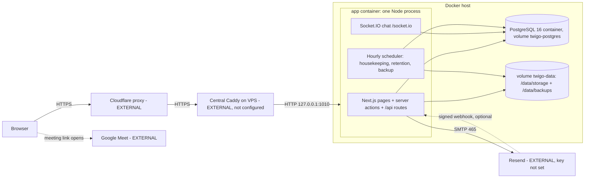

**Main database relationships (simplified)**

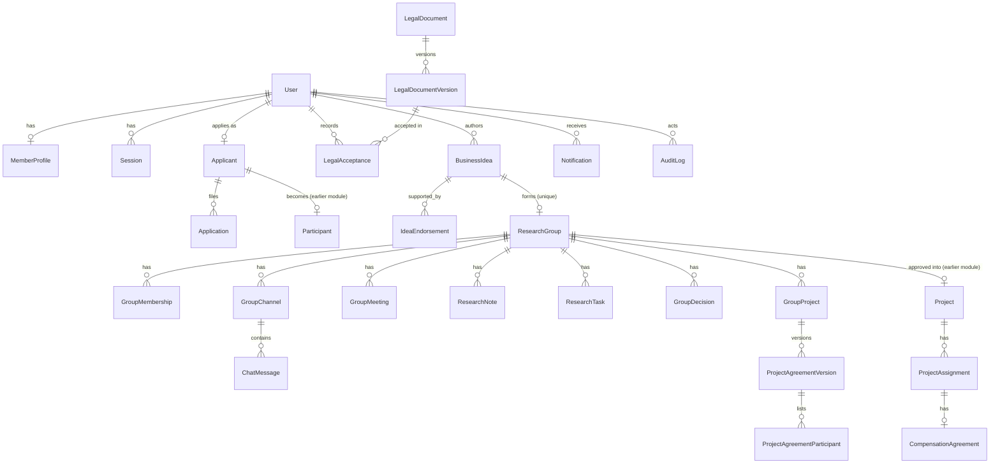

Standalone tables: `EmailDelivery`, `EmailTemplate`, `ContactInquiry`, `SupportLedgerEntry`, `SupportReport`, `PrivacyRequest`, `ContentReport`, `StoredFile`, `JobRun`, `SiteContent`, `OrgSetting`.

**Security boundaries**

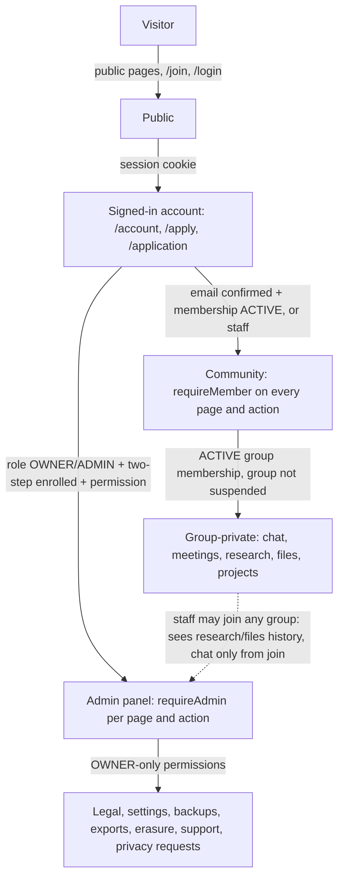

**Data flow: application to group**

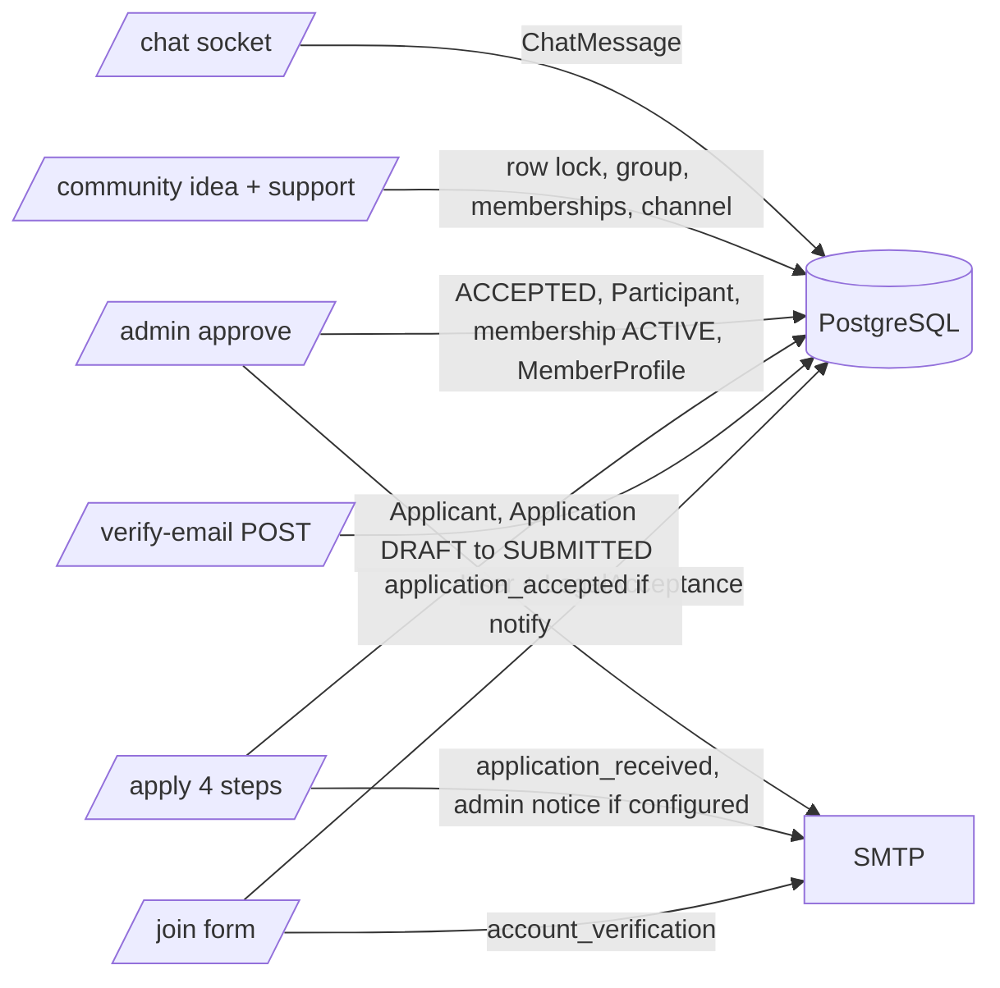

### 15.5 Check against the intended production setup

| Intended | Repository state | Status |
| --- | --- | --- |
| https://twigo.space | `SITE_URL` must be `https://` and non-local; the deployment script requires exactly `https://twigo.space`; emails link to `SITE_URL` [Source; test passed, Executed] | Configured; **site not live** (525 on 23 Nov) [Docs] |
| Ubuntu VPS | Bash deployment script for Ubuntu with Docker [Source]; tested only in WSL/Docker on the development computer [Docs] | Prepared, not run successfully on the VPS [Docs] |
| Docker | Dockerfile and Compose present [Source]; image built and run in WSL [Docs] | Not verified today |
| Port 1010 | App listens on 1010 in production and is published only on `127.0.0.1:1010` [Source]; the script asserts this binding [Source] | Matches |
| PostgreSQL | `postgres:16-alpine` container, private, healthy-check gated [Source] | Matches |
| Existing central Caddy | **No Caddyfile in the repository**; registration is a printed manual step; requires `trusted_proxies` for Cloudflare and WebSocket upgrade for `/socket.io`. If Caddy itself runs in Docker it cannot reach `127.0.0.1:1010` and the binding must change — which case applies is unknown [Source; Docs] | EXTERNAL DEPENDENCY, not done |
| Resend SMTP | Settings shape matches; key empty; never sent a real email [Source; Docs] | EXTERNAL DEPENDENCY, not done |
| Deployment | `release/` holds `twigo-rc5-2026-11-23` (commit `b7115c8`); HEAD is one commit later (template change only) and the uncommitted legal-page edits are **not** in rc5 [Source] | Not deployed; first real runs failed at the settings check [Docs] |

---

## 16. User Journey Diagrams

Steps that do not exist in the software are drawn as **MISSING**.

**A. Visitor → homepage → understanding → registration → application**

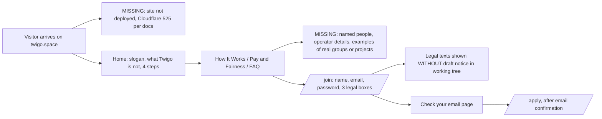

**B. Registration → email verification → application → review → approval → dashboard**

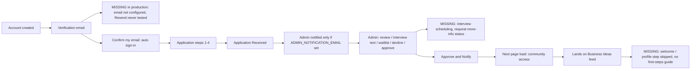

**C. Member → idea → support → group formation → participation**

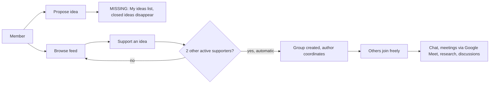

**D. Group → discussion → research → responsibilities → agreement → execution → completion**

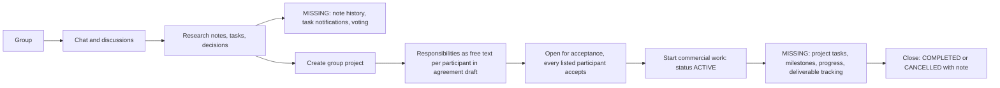

**E. Customer opportunity → revenue → compensation agreement → contribution records → distribution**

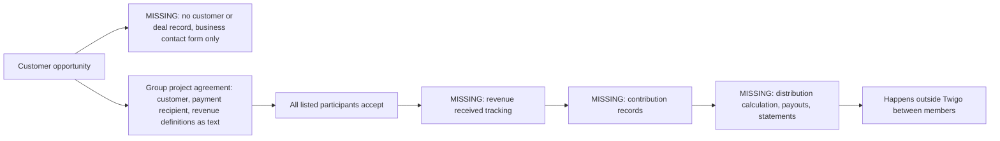

**F. Admin: applications → members → groups → projects → email → security/system**

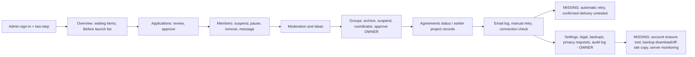

---

## 17. UX and Operational Problems

Written from the point of view of a non-technical American visitor or member. Necessary fixes and optional improvements are separated in Section 19.

### 17.1 Confusing terms
- "Project group", "Research" tab, "Support" an idea, "Founding contributor" (emails) vs "member" (site), "Group Participation Agreement" vs "project agreement", "Earlier project records" vs group "Projects", "Commercially active". A first-time user has to learn about eight internal terms before doing anything.
- The slogan "Together We Innovate, Grow & Opportunity" reads as a typo.

### 17.2 Navigation, links, dead ends
- No broken links were found.
- FAQ mentions the contact page and the IP policy without linking them; About, Participation and Pay & Fairness have no Join button in the page body.
- `/apply` sends signed-out visitors to Sign Up rather than Sign In, which confuses returning applicants.
- A member who closes an idea cannot find it again. A deactivated person who tries to come back is told to sign in or reset their password, neither of which works.
- Removed group members still see "Join group" buttons.

### 17.3 Missing notifications
- Administrators are not emailed about new applications unless `ADMIN_NOTIFICATION_EMAIL` is set; they are never told when an applicant withdraws.
- Authors are not told when their idea, comment or discussion is removed.
- Members are not told when their group is archived or suspended, when a new policy version is published, or when their privacy request is answered.
- Task assignees are not notified; new chat messages produce no notification.

### 17.4 Unclear permissions and privacy
- Members may believe administrators cannot see their group work; in fact an administrator who joins sees all past research, tasks, decisions and files (chat only from joining).
- Every group member sees everyone's compensation terms, including drafts.
- Discussions inside a group are open to every member of the community.
- The approved member's full legal name becomes their public display name without asking.

### 17.5 Onboarding, business and compensation process
- No first-steps guidance after approval.
- How a group finds a customer, invoices, receives money and pays members is entirely outside the software; the site explains principles but gives no practical path.
- The acceptance email says "you can now sign in" even when the person still has to create or confirm an account.
- The interview email says "Reply to this email" but comes from a no-reply address.
- Stale documentation: `docs/FINANCIAL-TRANSPARENCY.md` mentions a non-existent permission; `docs/ONBOARDING.md` describes an older sign-up; `docs/EMAIL.md` names an older delivery header and says the domain is not chosen; the implementation report describes the earlier project module as owner-only.

### 17.6 Mobile
- The member feed works on a phone with a bottom navigation bar [Executed]. On laptops narrower than 1,280 px the "My Groups / New groups / New for you" column is hidden. The chat page showed 8 px of horizontal overflow at 1,024 px [Executed].

### 17.7 Operational
- Not deployed; real email not working; Caddy not configured; backups on the same server and excluding uploaded files; rate limits reset on every restart; manual email retry only; only one server instance possible.

---

## 18. Implementation Status Matrix

| # | Feature | Intended purpose | Actual implementation | Verification method | Status | Evidence | Remaining issues |
| --- | --- | --- | --- | --- | --- | --- | --- |
| 1 | Public website pages | Explain Twigo to visitors | 21 public pages, redirects for old addresses | HTTP crawl + source | VERIFIED | 3.3; all 200 | Copy inconsistencies; slogan |
| 2 | Admin-editable site content | Let staff update text | Six content blocks; rest fixed in code | Source | IMPLEMENTED — NOT FULLY VERIFIED | `src/lib/content/*` | Name override ignored; two taglines |
| 3 | Contact and business inquiry form | Let visitors ask questions | Stored inquiries; admin email only if configured | Source | IMPLEMENTED — NOT FULLY VERIFIED | `src/server/contact.ts` | Admin may never be emailed |
| 4 | Responsive / phone layout | Usable on phones | Responsive layouts, phone menu, bottom nav | One page in browser + docs | IMPLEMENTED — NOT FULLY VERIFIED | 2.5 step 4 | Side column hidden <1,280 px; 8 px chat overflow |
| 5 | Account registration | Create an account | Fields, scrypt, 3 legal records, anti-enumeration | Browser + tests | VERIFIED | 4.1 | No CAPTCHA; draft disclosure removed |
| 6 | Email verification | Prove address ownership | 24 h single-use link, POST confirm, auto sign-in | Browser (local capture) | VERIFIED | 4.2 | Production depends on real email |
| 7 | Sign-in and sessions | Secure access | DB sessions, absolute expiry, session list | Browser + source | VERIFIED | 4.3 | — |
| 8 | Two-step verification | Protect admin accounts | TOTP + recovery codes, required for admin panel | Browser (owner) + tests | VERIFIED | 4.3 | Not required for staff in community; replay cache in memory |
| 9 | Password reset | Regain access | 1 h single-use link, ends all sessions | Source | IMPLEMENTED — NOT FULLY VERIFIED | 4.5 | Needs real email |
| 10 | Rate limiting and lockout | Slow attacks | In-memory fixed windows | Source | PARTIALLY IMPLEMENTED | `src/lib/rate-limit.ts` | Reset on restart; depends on proxy setup |
| 11 | Account self-service | Members manage their account | Email change, sessions, optional 2FA, close account | Source | IMPLEMENTED — NOT FULLY VERIFIED | `src/app/account/*` | Unverified accounts can use it; deactivation dead end |
| 12 | Membership application form | Collect applicant information | 4 steps, saved per step | Browser | VERIFIED | 5.1 | No autosave; no edit after submit |
| 13 | Single-submission and duplicate protection | One open application | Unique index, row lock, idempotent submit | Tests passed | VERIFIED | 5.2 | Re-application overwrites shared fields |
| 14 | Application review statuses | Review, interview, waitlist, decline | Allowed-transition map, optional emails | Tests passed ("sends every onboarding email…") | VERIFIED | 5.4 | No "more info" status; notify on Under review sends nothing |
| 15 | Approval grants community access | Turn applicants into members | One transaction; deferred grant for unconfirmed accounts | Browser | VERIFIED | 5.5 | Acceptance email wording in pending case |
| 16 | Admin notification of new applications | Tell staff to review | Email only if `ADMIN_NOTIFICATION_EMAIL` set | Source | IMPLEMENTED — NOT FULLY VERIFIED | 5.3 | Off by default |
| 17 | First-login onboarding | Welcome and set up profile | Welcome page exists but is skipped for approved applicants | Browser + source | PARTIALLY IMPLEMENTED | 5.5 | Full name public without asking |
| 18 | Member home (ideas feed) | Starting point for members | Feed with search, filter, sort, live meetings | Browser | VERIFIED | 6.2 | No first-steps guidance |
| 19 | Idea submission | Members propose ideas | Required title/summary/category + optional fields | Source | IMPLEMENTED — NOT FULLY VERIFIED | 7.1 | — |
| 20 | Idea editing and revision history | Transparent changes | Revisions stored; minor/material choice | Tests passed | VERIFIED | 7.2 | Minor/material self-declared |
| 21 | Idea closing and visibility | Author can retire an idea | Close without reopen | Source | PARTIALLY IMPLEMENTED | 7.2 | Closed ideas vanish, contrary to on-screen text |
| 22 | Support votes and automatic group creation | Two supporters form a group | Threshold setting (2), row lock, unique idea per group | Browser + tests | VERIFIED | 7.4 | Supporter list vs counter; wrong message if author inactive |
| 23 | Group discovery and open joining | Find and join groups | Explore list; one-click join | Browser | VERIFIED | 8.2 | No size limit |
| 24 | Leaving, removal, coordinator succession | Keep groups running | Succession, admin-managed flag, auto-archive | Source | IMPLEMENTED — NOT FULLY VERIFIED | 8.3 | Coordinator role not restored |
| 25 | Admin group controls | Oversight of groups | Archive, reopen, suspend, assign, approve | Source | PARTIALLY IMPLEMENTED | 8.6 | Reopen resets stage; report-suspend inconsistent; no member notice |
| 26 | Real-time group chat | Group communication | Socket.IO, PostgreSQL persistence, re-checked access | Browser + DB | VERIFIED | 9.1 | No chat notifications |
| 27 | Reporting a chat message | Members flag abuse | Server supports it; **no button** | Source | NOT IMPLEMENTED | 9.1 | Contradicts on-screen promise |
| 28 | Meetings via Google Meet links | Voice/video meetings | Paste link, notify, attendance, one active meeting | Page in browser + source | IMPLEMENTED — NOT FULLY VERIFIED | 9.2 | Anyone with link can request entry |
| 29 | Native voice/video | — | None (by design) | Source | NOT IMPLEMENTED | 9.2 | — |
| 30 | Research workspace | Plan together | Notes, tasks, decisions, links | Source | IMPLEMENTED — NOT FULLY VERIFIED | 9.3 | No history; last save wins; no task notices |
| 31 | Group files | Share documents | Typed uploads, member-only downloads | Tests passed | VERIFIED | 9.3 | No virus scan; not in backups |
| 32 | Discussions and announcements | Asynchronous talk | Threads open to all members; coordinator announcements | Source | IMPLEMENTED — NOT FULLY VERIFIED | 9.3 | No edit; no moderation by coordinator |
| 33 | Notifications | Keep members informed | In-app + email per type | Source + captured emails | IMPLEMENTED — NOT FULLY VERIFIED | 9.4 | Several events not notified (17.3) |
| 34 | Moderation and reports | Handle abuse | Report queue, remove, suspend author | Source | PARTIALLY IMPLEMENTED | 12.2 | No chat report UI; authors not told; silent suspend failure |
| 35 | Group projects | Organize commercial work | Create, status, close; member-led | Source + tests | IMPLEMENTED — NOT FULLY VERIFIED | 10.2 | No tasks or progress; status lags |
| 36 | Project agreements | Fair, accepted terms | Versioned, fingerprinted, all-listed acceptance, activation rules | Tests passed | PARTIALLY IMPLEMENTED | 10.2 | Omission gap vs policy; terms visible to whole group |
| 37 | Earlier admin-run projects | Historical module | Full CRUD; owner compensation records | Source | IMPLEMENTED — NOT FULLY VERIFIED | 10.1 | Two project systems; no participant acceptance |
| 38 | Member-defined compensation splits | Members set splits | Free-text method and terms only | Source | PARTIALLY IMPLEMENTED | 11.2 | No amounts, no totals check |
| 39 | Contribution records | Record who did what | None | Source | NOT IMPLEMENTED | 11.2 | — |
| 40 | Revenue tracking, distribution and payouts | Track money to members | None | Source | NOT IMPLEMENTED | 11.2 | — |
| 41 | No commission or fees in software | Platform takes nothing | No calculation anywhere; fixed agreement sentence | Tests passed (`twigo-revenue-model`) | VERIFIED | 11.1 | — |
| 42 | Community Support ledger and reports | Transparent voluntary support | Owner ledger; frozen reports | Source + tests | IMPLEMENTED — NOT FULLY VERIFIED | 11.4 | No corrections; "no support received" wording |
| 43 | Online contributions / payments | Accept support online | Hard-coded off; no provider | Source + tests | NOT IMPLEMENTED | 11.4 | — |
| 44 | Admin roles and permissions | Separate OWNER and ADMIN powers | Permission table; guard on every action | Source + tests; owner in browser | IMPLEMENTED — NOT FULLY VERIFIED | 12 | ADMIN not exercised in browser; uneven password re-entry |
| 45 | Audit log | Accountability | Many actions logged; best-effort | Source + DB | PARTIALLY IMPLEMENTED | 14.3 | Reads not logged; not tamper-resistant |
| 46 | Legal versioning and acceptance records | Record what people accepted | Versions, fingerprints, per-version acceptances | DB query + tests | VERIFIED | 14.1 | — |
| 47 | Public disclosure of legal document status | Tell people when texts are drafts | Removed in the uncommitted working tree while texts are pending | Browser + DB | NOT WORKING | 2.4 | Critical (C-1) |
| 48 | Legal notices (operator, jurisdiction) | Identify the operator | Taken from settings and auto-confirmed | Browser + source | PARTIALLY IMPLEMENTED | 14.1 | Contradicts Terms and Privacy texts |
| 49 | Personal data export | Give people their data | JSON export, password re-entry | Tests passed | VERIFIED | 14.2 | Some categories excluded |
| 50 | Account and data erasure | Delete on request | None; manual request only | Source | NOT IMPLEMENTED | 14.2 | — |
| 51 | Privacy requests | Handle data requests | Request form, owner handling | Source + tests | PARTIALLY IMPLEMENTED | 14.2 | Requester not notified; no deadlines; no erase tool |
| 52 | Data retention job | Delete old data | Daily job with owner-set periods | Source | IMPLEMENTED — NOT FULLY VERIFIED | 14.2 | Policy text fixed; backups not mentioned |
| 53 | Email templates, delivery log, manual retry | Reliable, honest email records | 15 templates, honest statuses, manual retry, local capture | Browser (CAPTURED_LOCALLY) + tests | VERIFIED | 13 | No automatic retry |
| 54 | Real email delivery (Resend) | Reach real inboxes | SMTP settings shape only; key empty | Docs | EXTERNAL DEPENDENCY | 13.6 | Never tested |
| 55 | Delivery confirmation webhook | Know mail arrived | Signed webhook; matching to emails | Tests (simulated) | UNKNOWN | 13.4 | Real Resend matching untested |
| 56 | Scheduled jobs | Housekeeping, retention, backup | Hourly in-process scheduler | Source + tests | IMPLEMENTED — NOT FULLY VERIFIED | 15.1 | One failure skips the rest of the tick |
| 57 | Database backups and restore | Recover from loss | Encrypted daily DB backups; verified restore | Tests passed | PARTIALLY IMPLEMENTED | 15.2 | Uploads excluded; same server; off-site manual |
| 58 | Docker production configuration | Run on the VPS | Dockerfile, Compose, port 127.0.0.1:1010 | Source + docs | IMPLEMENTED — NOT FULLY VERIFIED | 15.2 | Dev dependencies in image |
| 59 | Deployment tooling | One-click deploy | PowerShell launcher + Bash script with backups and rollback | Source + docs | IMPLEMENTED — NOT FULLY VERIFIED | 15.5 | First real runs failed (per docs) |
| 60 | Production site at twigo.space | Public availability | Not deployed | Docs | NOT WORKING | 15.5 | Cloudflare 525 on 23 Nov |
| 61 | TLS and reverse proxy (central Caddy, Cloudflare) | Secure public access | No Caddy config in repo; manual step | Source + docs | EXTERNAL DEPENDENCY | 15.5 | `trusted_proxies`, WebSocket, network reachability |
| 62 | Health endpoint | Monitoring | Settings + database check | HTTP | VERIFIED | 2.3 | Does not check email, storage, chat |
| 63 | Single-instance enforcement | Avoid split state | Advisory lock refuses a second instance | Source | IMPLEMENTED — NOT FULLY VERIFIED | 15.1 | Lock not re-acquired after a lost connection [Inferred] |
| 64 | Interview scheduling | Arrange interviews | Status + free text only | Source | NOT IMPLEMENTED | 5.4 | Replies go to a no-reply address |

**Totals (64 features):**

| Status | Count |
| --- | --- |
| VERIFIED | 20 |
| IMPLEMENTED — NOT FULLY VERIFIED | 21 |
| PARTIALLY IMPLEMENTED | 11 |
| NOT WORKING | 2 |
| EXTERNAL DEPENDENCY | 2 |
| NOT IMPLEMENTED | 7 |
| UNKNOWN | 1 |
| **Total** | **64** |

(20 + 21 + 11 + 2 + 2 + 7 + 1 = 64.)

---

## 19. Prioritized Findings

Each finding: **What / Where / Who is affected / Why it matters / Evidence / Recommended resolution / Before public recruitment?** Tags: technical, UX, operational, business-model, legal/policy. "Necessary" fixes are required before recruiting; "optional" ones are improvements.

### CRITICAL

**C-1. Draft legal documents are presented and accepted without any draft disclosure** — *legal/policy* — **Necessary**
- Where: uncommitted edits to `src/app/(site)/legal/**` and `src/app/(auth)/join/page.tsx`.
- Who: every visitor and every person who signs up.
- Why: people accept texts whose status is `PENDING_LEGAL_REVIEW` and which themselves say parts will be completed "before this policy is published"; superseded versions are no longer marked as out of force.
- Evidence: 2.4; `/legal/terms` without banner while the database shows `PENDING_LEGAL_REVIEW`; acceptance rows for the synthetic account [Executed].
- Resolution: either keep the draft notices until reviewed texts are actually published in the production database, or publish the reviewed versions (with the self-referencing "before publication" sentences resolved) before removing the notices. The edits should not be committed as they are without that decision.

**C-2. The site is not deployed** — *operational* — **Necessary**
- Where: VPS, central Caddy, Cloudflare.
- Who: everyone.
- Why: nobody can reach Twigo.
- Evidence: `docs/TWIGO-PROGRESS.md`, `docs/DEPLOYMENT.md` §0 (525; first runs failed at step 3) [Docs]; no record of success.
- Resolution: complete the server settings, run `deploy-twigo.ps1`, register the site on the central Caddy (WebSocket for `/socket.io`, Cloudflare `trusted_proxies`, reachable upstream), confirm `/api/health` and a WebSocket upgrade from outside.

**C-3. Real email has never been delivered** — *operational* — **Necessary**
- Where: `SMTP_PASSWORD` (empty), Resend account and domain.
- Who: every new user (sign-up requires email confirmation), every applicant, administrators.
- Why: without working email nobody can join; the app starts anyway and records "not configured".
- Evidence: 13.1, 13.6 [Source; Docs].
- Resolution: enter the Resend key on the server, confirm the domain is verified in Resend, send one test email from Admin → Email to a real inbox, sign up once with a real address, and set `ADMIN_NOTIFICATION_EMAIL`.

### HIGH

**H-1. Operator and governing-law statements contradict each other** — *legal/policy* — Necessary
- Where: `src/server/legal-notices.ts:44-57` vs Terms §1/§21, Privacy Policy, About, Home.
- Who: visitors, members, anyone relying on the policies.
- Why: Legal Notices would show an operator and "Sacramento, California" as both jurisdiction and governing law (auto-confirmed), while the policy texts say these are undetermined.
- Evidence: 14.1 [Source]. Resolution: decide the facts with counsel and make the policy texts, About/Home copy and Legal Notices state the same thing.

**H-2. No way to erase an account or community content** — *legal/policy* — Necessary before public recruitment (US privacy expectations; no compliance claim made)
- Where: `src/server/privacy.ts`, `privacy-requests.ts`.
- Who: any member asking for deletion; the owner handling it.
- Evidence: 14.2 [Source]. Resolution: at minimum a documented manual procedure the owner can actually perform; preferably a simple owner-only "erase this account" action. Mention backups and processors (Cloudflare, host, Resend) in the Privacy Policy.

**H-3. Backups are on the same server and exclude uploaded files** — *operational* — Necessary
- Where: `docker-compose.yml` (`twigo-data` volume), `src/ops/backup.ts`.
- Who: everyone, if the server or disk is lost.
- Evidence: 15.2 [Source]. Resolution: a scheduled off-server copy of `/data/backups` and of `/data/storage`, and one test restore from that copy.

**H-4. Administrators are not notified of new applications by default** — *operational* — Necessary
- Where: `ADMIN_NOTIFICATION_EMAIL` (empty default); withdrawals never notified.
- Who: applicants waiting for review; the founder.
- Evidence: 5.3 [Source]. Resolution: set the variable; check the admin overview daily.

**H-5. Members cannot report a chat message, although the chat promises reports** — *UX / safety* — Necessary
- Where: `src/components/community/chat.tsx`; server support in `reports.ts:45-54`.
- Who: members facing harassment or a fee/investment solicitation in chat.
- Evidence: 9.1 [Source]. Resolution: add a "Report" item on each message using the existing server function.

**H-6. Administrator access to group work is broader than members are told** — *legal/policy, UX* — Necessary (wording at least)
- Where: `groups.ts` join; `files.ts`; admin group page; chat and help text.
- Who: all group members.
- Evidence: 8.5 [Source]. Resolution: state plainly in the help and Guidelines that administrators who join a group can read its research and files; optionally audit administrator joins separately.

**H-7. Project agreement omission gap** — *business-model* — Necessary before groups handle real money
- Where: `src/server/community/group-projects.ts` (`openForAcceptance`, `acceptAgreement`).
- Who: participants of projects with money.
- Why: a coordinator can supersede an agreement by leaving a participant out of the next version.
- Evidence: 10.2 [Source]; no test. Resolution: require acceptance (or recorded withdrawal) by every participant of the version in force before a new version can supersede it, or at least notify and warn.

**H-8. Rate limits depend on proxy configuration and reset on restart** — *technical* — Necessary to configure; optional to redesign
- Where: `src/lib/rate-limit.ts`, `TRUSTED_PROXY_HOPS`, central Caddy.
- Evidence: 14.3 [Source; Inferred]. Resolution: configure Caddy `trusted_proxies` for Cloudflare and verify that two different visitors are seen with different addresses (check one sign-in log line). No redesign needed at pilot scale.

### MEDIUM

| ID | Finding | Tag | Where | Recommended resolution | Before recruitment? |
| --- | --- | --- | --- | --- | --- |
| M-1 | Approved members skip the welcome page; full name becomes public display name | UX / privacy | `admin/applications.ts:208`, `membership-grant.ts:42` | Send new members through the welcome/profile step once | Necessary (small) |
| M-2 | Acceptance email says "you can now sign in" in the pending-account case | UX | `templates.ts:176-180` | Adjust wording for that case | Optional |
| M-3 | Webhook delivery confirmation may never match real Resend events | technical | `src/lib/email/webhook.ts` | Test once with a real Resend webhook; otherwise treat "Accepted" as final | Optional (after C-3) |
| M-4 | No automatic email retry | operational | `src/ops/scheduler.ts` | Check Admin → Email daily during the pilot | Optional |
| M-5 | Closed ideas disappear although the screen says they stay visible | UX | `ideas.ts:165`, `ideas/[id]/page.tsx:149` | Show closed ideas to their author or fix the wording | Optional |
| M-6 | Group reopen resets the stage to FORMING; report-based suspension skips chat disconnect; members not told of archive/suspend | technical / UX | `groups.ts:500-530`, `reports.ts:118-119` | Small consistency fixes | Optional |
| M-7 | Authors not told when content is removed; "suspend author" silently fails for staff | UX | `reports.ts:92-135` | Notify the author; show the failure | Optional |
| M-8 | Privacy-request answers are not notified to the requester | legal/policy | `privacy-requests.ts` | Send a notification | Necessary (small) |
| M-9 | Everyone in a group sees all compensation terms, including drafts | business-model | `group-projects.ts:147-171` | State it clearly on the Projects tab, or limit drafts to listed participants | Necessary (wording) |
| M-10 | Two project systems and the owner's "Approve for project" creating an earlier-style record | UX / business-model | 10.1 | Decide whether to retire the earlier module; hide it if unused | Optional |
| M-11 | Status stays "Agreement waiting for acceptance" after everyone accepted | UX | `group-projects.ts:344-350` | Prompt the coordinator to start work | Optional |
| M-12 | Interview "Reply to this email" from a no-reply sender; no Reply-To | UX / operational | `src/lib/email` | Set a Reply-To or change the text | Necessary (small) |
| M-13 | Withdrawn applications not reported to administrators | operational | `membership-application.ts:196-203` | Notification or overview count | Optional |
| M-14 | Community Support page: "No support has been received" depends on publication, not on receipts | legal/policy | `support/page.tsx:63` | Reword | Optional (only matters once support is recorded) |
| M-15 | Re-acceptance gate not applied to `/account`, downloads and chat; no email when policies change | legal/policy | `guard.ts`, `legal.ts:181-208` | Notify members by email when a material change is published | Optional |
| M-16 | Staff can use community and chat without enrolling two-step verification | technical | `guard.ts` | Enroll two-step for every staff account at creation (already prompted at first admin visit) | Optional |
| M-17 | Research notes overwrite without history; one-click deletes without confirmation | UX | `research.ts`, research page | Add confirmation on delete | Optional |
| M-18 | Deactivated users are trapped (told to sign in/reset; both fail) | UX | `service.ts:75`, `accounts.ts:163` | Tell them to contact the operator | Optional |

### LOW

| ID | Finding | Tag | Recommended resolution | Before recruitment? |
| --- | --- | --- | --- | --- |
| L-1 | Slogan grammar | UX | Founder's decision (alternatives listed in `docs/TWIGO-OPEN-DECISIONS.md` item 11) | Optional |
| L-2 | "5 minutes" vs "10 minutes" to apply; fixed "two members" text | UX | Align wording | Optional |
| L-3 | FAQ and About lack links / Join buttons | UX | Add links | Optional |
| L-4 | `/join` in sitemap but noindex | technical | Remove from sitemap | Optional |
| L-5 | Supporter list includes people not counted | UX | Show only counted supporters, or explain | Optional |
| L-6 | Wrong "Your idea" message to first supporter when the author is inactive | technical | Fix the recipient | Optional |
| L-7 | Unvalidated admin action values (ideas, groups) | technical | Validate | Optional |
| L-8 | Template test email sends raw placeholders; test emails not audited | technical | Minor | Optional |
| L-9 | 8 px horizontal overflow on chat at 1,024 px; side column hidden below 1,280 px | UX | Minor CSS | Optional |
| L-10 | Dead code and unused events (`group:updated`, two meeting helpers, `failedLogins`, `RETENTION_DAYS_DECLINED`, `timeZone`) | technical | Remove later | Optional |
| L-11 | Development dependencies in the production image | technical | Optional slimming | Optional |
| L-12 | Stale documentation (17.5) | operational | Update docs | Optional |
| L-13 | Hard-coded "privacy notice version" string on applications | legal/policy | Link to the legal version or remove the label | Optional |
| L-14 | `error.tsx` has no link home; no `global-error.tsx` | UX | Add a home link | Optional |

---

## 20. Readiness for US Public Recruitment

Context assumed: remote participation, open to all backgrounds, AI data annotation and evaluation as early areas but not the only ones.

| # | Question | Answer | Evidence |
| --- | --- | --- | --- |
| 1 | Understandable within minutes? | **Partly.** The pages are plain and honest but define Twigo mostly by what it is not and use internal terms; a visitor needs several pages to understand the flow | 3.5, 17.1 |
| 2 | Clearly different from a job board? | **Yes in words** ("not an employer, recruitment agency, investment or job board"); but "Current opportunities" on `/participation` and the phrase "founding contributor" may still suggest jobs. Nothing mentions AI data annotation specifically [Source: category "AI & Data Operations" exists in the application] | 3.3 |
| 3 | No guaranteed employment or income made clear? | **Yes** — footer, Pay & Fairness, and the application confirmation tick | 3.1, 5.1 |
| 4 | No fees or mandatory investment made clear? | **Yes** — repeated on home, footer, sign-up and application; no payment code exists | 11.1 |
| 5 | Can non-technical people see how they can contribute? | **Partly.** Categories and examples exist (participation page, application examples such as "retired teacher"), but after approval there is no guidance on what to do first | 6.2 |
| 6 | Is idea discovery easy? | **Yes** — the feed is the home screen, with search, category and sort [Executed] | 6.2 |
| 7 | Finding and joining groups easy? | **Yes** — Explore Groups, one-click joining [Executed] | 8.2 |
| 8 | Are group projects understandable? | **Not yet.** Two project concepts, a long agreement form with legal and financial terms, and a status that lags | 10, 17.1 |
| 9 | Is the compensation model clear? | **Principle yes, practice no.** "No commission, members decide" is clear; how money actually reaches members is not handled or explained step by step | 11 |
| 10 | Enough trust for an early-stage community? | **No, not yet.** No named people or operator details, contradictory operator/jurisdiction statements, legal texts without draft disclosure, and no working email | 3.5, 14.1 |
| 11 | Sign-up and application simple enough? | **Yes** — about five short screens after account creation [Executed] | 2.5 |
| 12 | Essential features reliable enough? | **Locally yes, in production unknown.** 438 automated tests passed and the core flows worked in the browser, but the production site, email and proxy are not in place | 2.3, 15.5 |

**Verdict**

| Scale | Verdict | Conditions |
| --- | --- | --- |
| **Small** (invited, up to about 30 people, founder supervising daily) | **Not ready today; ready after the five actions in 22.2** | Site deployed, real email working, legal-document state disclosed or reviewed texts published, admin notifications on, off-server backups |
| **Moderate** (open public sign-ups, up to a few hundred) | **Not ready** | Additionally: chat reporting, erasure procedure, consistent operator/legal facts, clearer onboarding and project explanation, monitoring, automatic email retry, administrator-access transparency |
| **Large** (thousands, paid advertising) | **Not ready** | Additionally: single-process design (in-memory limits, one instance), no moderation staffing tools beyond a queue, no contribution or revenue records, no load testing; these would need a deliberate later decision |

---

## 21. What Twigo Can Actually Do Today

In plain language, as it works on a developer's computer today (the public site is not online yet):

- **A visitor** can read about Twigo, its rules on money and fairness, and its policies, send a question through the contact form, and create a free account.
- **An applicant** confirms their email, fills in a short application about themselves, their skills and their time, and then sees its status ("Received", "Interview requested", "Waitlisted", "Declined", "Accepted"). They can withdraw and apply again later. They cannot edit after sending.
- **An approved member** sees a list of business ideas, can propose ideas, comment on them and support other people's ideas, browse and join any project group, and manage their profile, notification emails and account security. They can download a copy of their own data and ask for corrections or deletion (handled by hand by the owner).
- **An idea contributor** (author) gets a project group automatically as soon as two other members support the idea, becomes its coordinator, and can edit the idea with a visible history.
- **A group member** can chat in real time, share Google Meet links to talk by video or voice, keep shared notes, tasks, decisions, links and files, take part in open discussions, create a project and accept a written project agreement.
- **A coordinator** can also edit the group's description and stage, post announcements, remove members, hand over the role and prepare project agreements for everyone to accept.
- **An administrator** can review and approve applications, pause or remove members, handle reports, archive or suspend groups, see the status (not the content) of project agreements, send and retry emails, edit public website text and read the audit log. Two-step sign-in is required.
- **The owner** can do everything an administrator can, plus manage legal documents and legal notices, settings, backups, privacy requests, administrators, Community Support records, personal-data exports, and the earlier project and compensation records.

**What Twigo cannot do yet:** be reached on the internet; send real email; move, track or calculate any money; record who actually contributed what; let members report a chat message; erase an account; schedule interviews; host video calls itself (it links to Google Meet); run on more than one server.

**What must be done before large-scale US recruitment:** everything in 22.2, then the "moderate" conditions in Section 20, then a deliberate review of scale, moderation capacity, money handling between members, and legal positioning with counsel.

---

## 22. Final Conclusions and Next Steps

### 22.1 Conclusions

1. The software implements the core community model end to end and it works locally: account → confirmation → application → approval → ideas → automatic group at two supporters → open joining → chat, meetings, research → member-accepted project agreements. This was demonstrated today in the browser and by 438 passing automated tests.
2. Twigo is honest by design about money: no fees, no commission, no payments, no guarantees — and the code contains nothing that collects or calculates money. The flip side is that everything after "agreement accepted" (customers, revenue, contribution, payment) happens outside the platform and is not supported by it.
3. It is not in production: not deployed, no real email, no Caddy registration, backups not off-site.
4. The most serious current risk is legal presentation: the uncommitted working tree removes the draft notices from policies that are still unreviewed in every database examined, and the operator/governing-law statements contradict each other.
5. The privacy picture needs completing before public recruitment: no erasure tool, administrator access to group work broader than members are told, and incomplete policy statements about backups and processors.

### 22.2 The five most important actions before US recruitment

1. **Resolve the legal-document state** (C-1, H-1): either keep the draft notices, or publish the lawyer-reviewed versions (with the "before publication" sentences resolved) in the production database and make Legal Notices, Terms, Privacy Policy and the About/Home copy state the same operator and governing law. Do not commit the current legal-page edits without this decision.
2. **Deploy and connect** (C-2): complete the server settings, run the one-click deployment, register twigo.space on the central Caddy (WebSocket, Cloudflare `trusted_proxies`, reachable upstream), and confirm the health check, a sign-in and a chat message from outside.
3. **Make email work and visible** (C-3, H-4): set the Resend key, confirm the domain in Resend, send a real test email, do one real sign-up, and set `ADMIN_NOTIFICATION_EMAIL`.
4. **Protect the data** (H-3, H-2): schedule an off-server copy of database backups and uploaded files, test one restore, and write down (and make possible) how the owner erases an account on request.
5. **Close the member-safety and trust gaps that the screens already promise** (H-5, H-6, M-1, M-8): add "Report" to chat messages, tell members plainly what administrators can see when they join a group, send new members through the profile step instead of publishing their full name, and notify people when their privacy request is answered.

### 22.3 What this report did not do

No code, schema, design or configuration was changed; nothing was committed or pushed; nothing was deployed; the VPS, Cloudflare, Caddy and Resend were not contacted; no secret values were read. Playwright, deployment-script tests, type checking and linting were not run today.
